# DOC 1: System Architecture

> Architecture of the **Smart Healthcare Appointment and Patient Prioritization System** on the revised stack: **Next.js, React, Firebase (Auth + Firestore) and Node.js via Next.js route handlers.** This document supersedes Sections 9 and 10 of the master document (README).

| | |
|---|---|
| **Document** | DOC_1_SYSTEM_ARCHITECTURE |
| **Version** | 0.2 (Draft for review) |
| **Date** | 2026-10-25 |
| **Parent document** | Master Document (README.md) |
| **Course** | B.Tech CSE, 7th Semester, Engineering Clinics |
| **Related documents** | DOC_2 Firebase Setup, DOC_3 Database Schema, DOC_4 API Specification, DOC_5 Frontend Architecture, DOC_6 UI Design, DOC_7 Task Tracker (names provisional) |

---

## Table of Contents

1. [Purpose and Scope](#1-purpose-and-scope)
2. [Changes from the Master Document](#2-changes-from-the-master-document)
3. [Architectural Style](#3-architectural-style)
4. [High-Level Architecture](#4-high-level-architecture)
5. [Components and Responsibilities](#5-components-and-responsibilities)
6. [Roles, Accounts and Permissions](#6-roles-accounts-and-permissions)
7. [Trust Boundary: Direct Firestore vs Route Handlers](#7-trust-boundary-direct-firestore-vs-route-handlers)
8. [Shared Priority Engine Module](#8-shared-priority-engine-module)
9. [Key Flows](#9-key-flows)
10. [Key Design Decisions](#10-key-design-decisions)
11. [Security Architecture](#11-security-architecture)
12. [Environments and Deployment](#12-environments-and-deployment)
13. [Technology Stack](#13-technology-stack)
14. [Non-Functional Requirements Mapping](#14-non-functional-requirements-mapping)
15. [Risks and Limitations](#15-risks-and-limitations)
16. [Open Decisions](#16-open-decisions)
17. [Changelog](#17-changelog)

---

## 1. Purpose and Scope

This document defines **how the system is built**: the components, where each responsibility lives, how data and trust flow between them, and how the system is run locally and deployed.

**In scope:** component structure, trust boundary, authentication and role model, key flows, deployment, security approach.

**Not in scope (covered elsewhere):**

| Topic | Document |
|---|---|
| Firebase console setup steps | DOC_2 Firebase Setup |
| Firestore collections, fields, indexes, security rule code | DOC_3 Database Schema |
| Endpoint request and response contracts | DOC_4 API Specification |
| Next.js folder layout, routing, state handling | DOC_5 Frontend Architecture |
| Screens, colours, layout, accessibility | DOC_6 UI Design |
| Schedule, owners, milestones | DOC_7 Task Tracker |

The product scope, features (F1 to F13), requirements (FR and NFR) and the priority formula remain as defined in the master document, with the adjustments listed in Section 2.

---

## 2. Changes from the Master Document

| Area | Master document | This document |
|---|---|---|
| Backend | Java 17, Spring Boot, Maven | **Next.js route handlers** (Node.js runtime) |
| Separate API server | Spring Boot on port 8080 | **None.** No Express and no always-on server |
| Database | MySQL 8, relational tables | **Cloud Firestore** (NoSQL documents) |
| Authentication | Spring Security, BCrypt, self-issued JWT | **Firebase Authentication**; roles and permissions as custom claims |
| Frontend | React with Vite (SPA) | **Next.js (App Router) with React** |
| Hosting | Local machine, optional cloud | **Vercel** (Next.js) and **Firebase** (data and auth); also runs locally |
| Environments | One local setup | **One shared Firebase project** used by both local development and the Vercel deployment |
| Scheduler | Spring `@Scheduled` jobs | **No scheduler.** No-show is derived at read time (Section 10) |
| Reminder emails (F10) | Planned | **Deferred.** Booking confirmation email only |
| Simulation location (D5) | Java, reusing `PriorityService` | **JavaScript**, reusing the shared priority engine module (Section 8) |
| Receptionist (D4) | Admin handles walk-ins | **Separate Receptionist role** (Section 6) |
| Account creation | Doctors created by admin | Doctors **and staff** created by admin only; **admin can grant or restrict features per account** |
| Testing tools | JUnit, Mockito, MockMvc | Jest or Vitest, plus API tests against route handlers |

---

## 3. Architectural Style

A **client-heavy, serverless-style architecture** with a thin trusted layer:

- The browser (Next.js client components) talks **directly to Firestore** for reads and real-time listeners, protected by **security rules**.
- Operations that must not be trusted to the browser run in **Next.js route handlers** on the server, using the **Firebase Admin SDK**. These are short request/response calls, so no always-on process is needed.
- **Firebase Authentication** is the single identity provider. Roles and permissions travel with the user as **custom claims**.
- The **priority engine** is one shared JavaScript module used in three places: the browser (aging and sorting), the server (scoring at booking) and the simulation.

Why this style: free-tier friendly, no server that sleeps, real-time queue updates for free, and a small number of server operations that are easy to review and audit.

---

## 4. High-Level Architecture

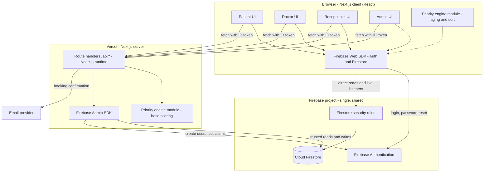

**Reading the diagram:** solid arrows from the browser to Firebase are *direct* calls limited by security rules. Arrows into route handlers are *trusted operations* where the server verifies the user's ID token, checks permissions, and then writes using the Admin SDK (which bypasses security rules, so every handler must do its own checks).

---

## 5. Components and Responsibilities

| Component | Responsibilities | Must never |
|---|---|---|
| **Next.js client (React)** | Role-based UI, forms, route guards, direct Firestore reads and listeners, live queue with local aging, i18n (English and Hindi) | Write scores, config, audit entries, roles or claims; be treated as a security boundary |
| **Route handlers (`/api/*`)** | Verify ID token and permissions; booking and scoring; check-in; override; config updates; user and permission management; sending email; opportunistic no-show sweep | Trust any score, role or time sent by the client; skip the audit log |
| **Firebase Admin SDK** | Privileged access to Firestore and Auth from route handlers only | Be imported into client code; have its key committed to Git |
| **Firebase Authentication** | Identity, password storage, login, forgot-password email, account disabling | Be the only authorization layer (claims and rules still apply) |
| **Cloud Firestore + security rules** | Storage; deny-by-default access; role and ownership checks on direct reads | Allow client writes to scores, config, audit log, roles or permissions |
| **Priority engine module** | Pure functions: base score, aging, final score, sorting, red-flag evaluation | Touch the database, network or UI (keeps it testable and reusable by the simulation) |
| **Email provider** | Booking confirmation and cancellation emails | Receive symptom details or other sensitive content |

---

## 6. Roles, Accounts and Permissions

### 6.1 Roles

| Role | Description |
|---|---|
| **Patient** | Self-registers. Books own appointments, submits symptoms, tracks queue position and history. |
| **Doctor** | Created by admin. Views own prioritized queue, runs consultations, may override priority. |
| **Receptionist** | Created by admin. Handles **offline patients**: finds or creates a patient profile, books a slot on the patient's behalf, records symptoms, checks in, cancels on behalf. |
| **Admin** | Seeded once, afterwards created by another admin. Full control of users, roles, permissions, configuration, reports, audit log and simulation. |

> The Receptionist role resolves open decision **D4** of the master document.

### 6.2 Account creation and login rules

| Role | Created by | Login | Password recovery |
|---|---|---|---|
| Patient | **Self-registration** | Email + password | Forgot password (Firebase reset email) |
| Doctor | **Admin only** | Credentials issued by admin; forced password change on first login | Forgot password |
| Receptionist and other staff | **Admin only** | Same as doctor | Forgot password |
| Admin | Seed script, then **admin only** | Same as doctor | Forgot password |

**Doctors and staff cannot sign themselves up.** Because Firebase's web configuration is public, someone could technically call the sign-up function directly. The architecture makes that harmless:

1. **An account without a role claim has no access at all.** Security rules and route handlers deny everything for such users.
2. Roles are only ever assigned by a route handler running the Admin SDK. Patient role assignment happens in `complete-patient-profile` after a normal sign-up, and doctor, receptionist and admin roles are assignable only by an admin through the user-management handler.
3. Stray accounts created outside the registration flow remain role-less and inert.

### 6.3 Permission model: role defaults plus per-user overrides

Access is controlled in two layers:

```
effectivePermissions = (roleDefaults + grants) - denies
```

- **Role defaults:** each role comes with a default bundle of permissions.
- **Grants:** the admin can give any single account an extra permission (for example, let one receptionist view reports).
- **Denies:** the admin can remove a specific permission from any single account. **A deny always wins.**
- **Disable:** the admin can disable an account completely, which blocks all access.

This is how the admin can "allow anyone in the institution to access some feature" or "restrict an account from getting any feature".

**Draft permission keys** (the final list is owned by DOC_3 Database Schema):

| Group | Keys |
|---|---|
| Users | `users.manage`, `permissions.manage` |
| Catalogue | `doctors.manage`, `specializations.manage`, `slots.manage`, `slots.manage_own` |
| Appointments | `appointments.book_self`, `appointments.book_for_patient`, `appointments.register_walkin`, `appointments.checkin`, `appointments.cancel_for_patient`, `appointments.edit_symptoms` |
| Patients | `patients.create_profile`, `patients.search` |
| Queue | `queue.view_own`, `queue.view_all`, `queue.view_breakdown` |
| Consultation | `consultation.manage` |
| Priority | `priority.override` |
| Administration | `config.edit`, `reports.view`, `audit.view`, `simulation.run` |

**Default permissions by role** (`Grantable` = not given by default, but the admin may grant it to an individual account):

| Capability | Patient | Doctor | Receptionist | Admin |
|---|:--:|:--:|:--:|:--:|
| Self-register | Yes | No | No | No |
| Login and forgot password | Yes | Yes | Yes | Yes |
| View and edit own profile | Yes | Yes | Yes | Yes |
| Search doctors and view slots | Yes | Own slots | Yes | Yes |
| Book own appointment | Yes | No | No | n/a |
| Book a slot on behalf of a patient (offline) | No | No | **Yes** | Yes |
| Create a walk-in patient profile | No | No | **Yes** | Yes |
| Register a walk-in (no slot, immediate check-in) | No | No | **Yes** | Yes |
| Submit or edit symptom form before check-in | Own | No | **Yes** (on behalf) | Yes |
| Cancel appointment | Own | No | **Yes** (on behalf) | Yes |
| Check in | Self | No | **Yes** | Yes |
| See own queue position and wait estimate | Yes | n/a | n/a | n/a |
| View prioritized queue | No | Own queue | All (status and position) | All |
| View score breakdown | No (see 16) | Own patients | Grantable | All |
| Start and complete consultation, notes | No | Yes | No | No |
| Override priority (reason required) | No | Yes | Grantable | Yes |
| Manage doctors and specializations | No | No | Grantable | Yes |
| Manage slots | No | Own | Grantable | Yes |
| Edit scoring configuration | No | No | No | Yes |
| View reports | No | Own stats | Grantable | Yes |
| View audit log | No | No | No | Yes |
| Run simulation | No | No | No | Yes |
| Manage users, roles and permissions | No | No | No | Yes |

### 6.4 Where permissions are stored and enforced

| Concern | Design |
|---|---|
| Source of truth | The user's document in Firestore (role, grants, denies, `active`, `permVersion`). Only route handlers write it. |
| Fast checks | A compact copy of `role` and the effective permission codes is written to the user's **custom claims** (limit: 1,000 bytes, enough for short codes). |
| Direct Firestore reads | Security rules check claims (role, permissions) plus ownership (for example a patient reads only own appointments). |
| Trusted operations | Route handlers verify the ID token (with revocation check), read the user document, and check the required permission before doing anything. |
| UI | The UI hides what a user cannot do, but this is a convenience only; enforcement is always in rules and handlers. |

### 6.5 Making permission changes take effect

Claims are embedded in the ID token, which is valid for up to about one hour. To make changes prompt:

1. The route handler updates the user document and claims and increments `permVersion`.
2. The affected user's browser listens to their own user document and **force-refreshes the ID token** when `permVersion` changes.
3. For **disable, role removal or demotion**, the handler also disables the Firebase user and **revokes refresh tokens**. Security rules for protected data additionally check the `active` flag in the user document, so a disabled account is blocked even while an old token is still valid (see decision O4 in Section 16).

### 6.6 Safety rails

- An admin cannot remove their own admin access, and the **last remaining admin cannot be demoted, denied or disabled**.
- **Every** user creation, role change, grant, deny, disable or enable is written to the audit log (actor, target, old value, new value, timestamp, reason).
- Newly created staff accounts start from role defaults only; extra access must be granted deliberately.

### 6.7 Offline patients without accounts

A patient who walks in and has never registered still needs a record. The system keeps a **walk-in patient profile** (name, phone, date of birth, gender, optional ABHA ID) with **no login**. The receptionist books against it. If that person registers online later, a staff member can link the offline profile to the new account after confirming identity (a matching phone number is a hint, not proof). This supports the unified queue (F4).

---

## 7. Trust Boundary: Direct Firestore vs Route Handlers

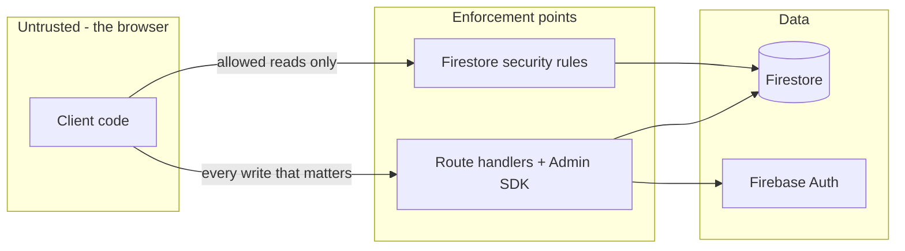

**Direct from the browser (reads protected by rules):**

| Operation | Notes |
|---|---|
| Read specializations, doctors, open slots | Authenticated users with a role |
| Read own profile and own appointments | Ownership check in rules |
| Doctor: live listener on own queue | Doctor's own queue only; `queue.view_all` for others |
| Receptionist and admin: queue overview, patient search | Per permission |
| Read own user document (permission changes) | Triggers token refresh |
| Edit own display name | Field-restricted by rules; phone changes and role or permission fields are never client-writable |

**Through route handlers (writes that must be trusted):**

| Operation | Why it cannot be client-side | Handler |
|---|---|---|
| Complete patient registration (assign patient role, create profile) | Role assignment | `POST /api/auth/complete-patient-profile` |
| Create doctor, receptionist or admin account | Admin SDK, claims, temp credentials | `POST /api/admin/users` |
| Change role, grant, deny, disable | Claims and audit | `PUT /api/admin/users/{uid}/access` |
| **Book appointment** (self or on behalf), compute score | Client must not set its own score; slot reservation needs a transaction | `POST /api/appointments` |
| Edit symptoms before check-in (rescore) | Rescoring is server-side | `PUT /api/appointments/{id}/symptoms` |
| Cancel, check in | Server timestamp; status rules | `PUT /api/appointments/{id}/cancel`, `/check-in` |
| Register walk-in | Same as booking, no slot | `POST /api/walk-ins` |
| Create offline patient profile | Patient code sequence and validation | `POST /api/patients` |
| Link offline profile to a registered account (staff-confirmed) | Repoints appointments and writes an audit entry | `POST /api/patients/{id}/link-account` |
| Patient queue position and wait estimate (read-only) | A patient cannot read other patients' appointments, so the server computes the position and returns only the number | `GET /api/appointments/{id}/queue-status` |
| Start and complete consultation | Status rules and notes | `PUT /api/appointments/{id}/start`, `/complete` |
| Priority override | Mandatory reason and audit entry | `POST /api/appointments/{id}/override` |
| Update scoring configuration | New config version and audit | `PUT /api/admin/config` |
| Manage doctors, specializations, slots | Validation, uniqueness | `/api/admin/...` |
| No-show sweep | Persist derived no-shows | `POST /api/appointments/sweep` |

Exact paths, bodies and error codes are defined in **DOC_4 API Specification**. The security rules deny all client writes to appointments, scores, config, audit log and user documents.

**Rule of thumb:** if a value affects ordering, access or the audit trail, the server writes it.

---

## 8. Shared Priority Engine Module

One small JavaScript package (for example `packages/priority-engine` or `src/lib/priority-engine`) with **pure functions and no I/O**:

| Function | Purpose |
|---|---|
| `evaluateRedFlags(symptoms, config)` | Decide if severity is forced to CRITICAL |
| `computeBase(patient, assessment, config)` | `BaseScore` with the per-component breakdown |
| `computeAging(checkInTime, now, config)` | `min(waitMinutes / divisor, cap)` |
| `computeFinal(appointment, now, config)` | `base + aging + manualAdjustment` |
| `sortQueue(appointments, now, config)` | Order by final score desc, then booking time asc (walk-ins by check-in time) |

| Used by | How |
|---|---|
| Route handlers | `computeBase` and `evaluateRedFlags` at booking and symptom edits; the result is stored with the config version |
| Browser (queue pages) | `computeFinal` and `sortQueue` on live Firestore data; recalculated locally on a timer so aging advances without extra Firestore reads |
| Simulation | The same functions on synthetic patients (satisfies RQ evaluation with the *real* algorithm) |
| Unit tests | Table rows, the six worked examples, boundaries such as age 5 vs 6 and 59 vs 60 |

Because aging uses the stored **server** check-in timestamp and the versioned config, any score can be reproduced later (NFR-05).

---

## 9. Key Flows

### 9.1 Patient registration

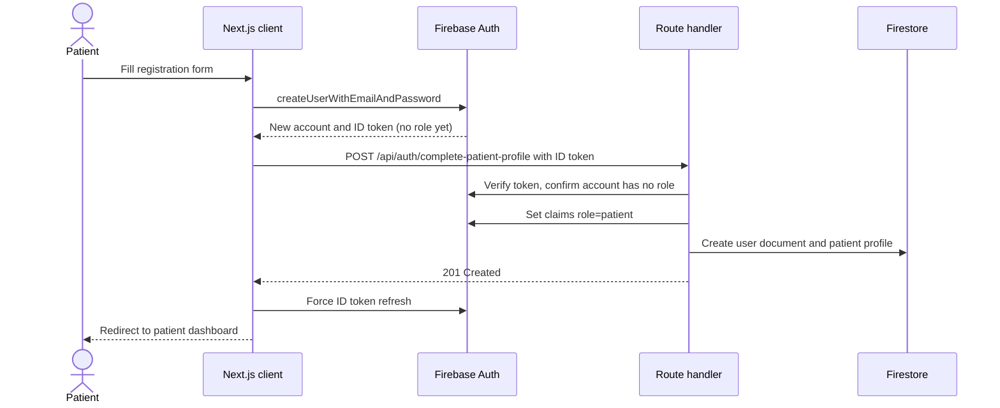

### 9.2 Admin creates a doctor or staff account

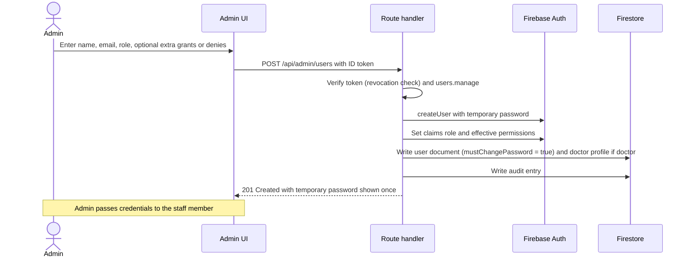

On first login the UI blocks every page until the password is changed, and route handlers reject requests while `mustChangePassword` is true. (Alternative to evaluate: email a password-setup link instead of showing a temporary password; see Section 16.)

### 9.3 Online booking by a patient

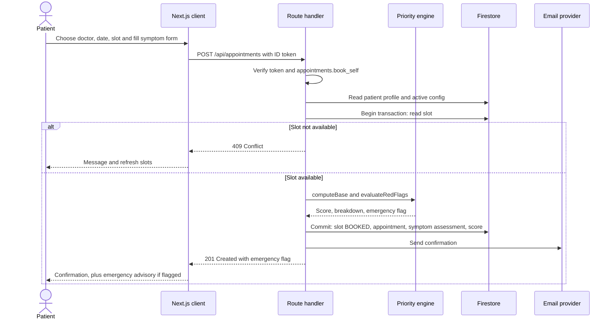

### 9.4 Offline booking by the receptionist

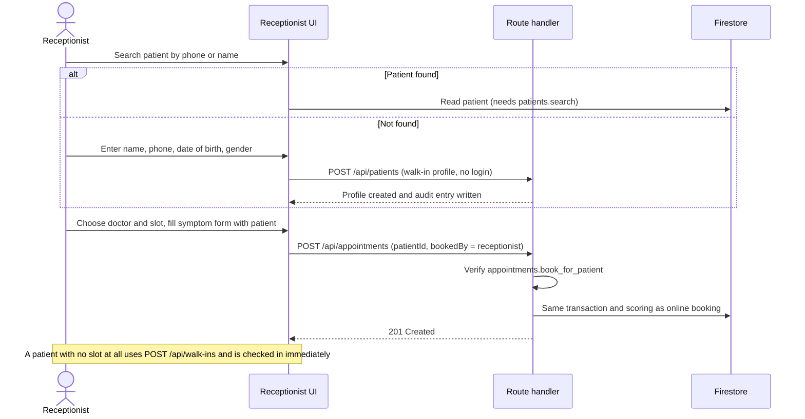

The appointment records **who booked it and how** (`ONLINE`, `RECEPTION`, `WALK_IN`) so reports and the paper can separate the sources.

### 9.5 Check-in and live prioritized queue

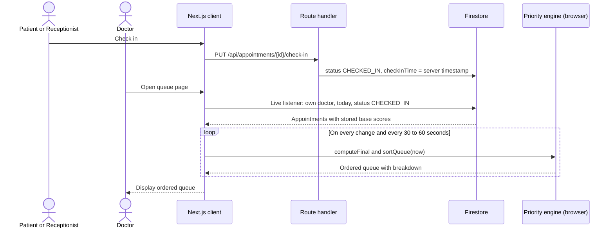

Aging advances locally on a timer, so the doctor's screen stays correct without re-reading Firestore.

### 9.6 Priority override

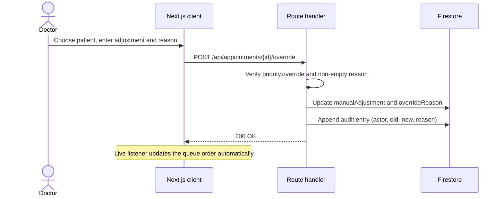

### 9.7 Changing a user's access

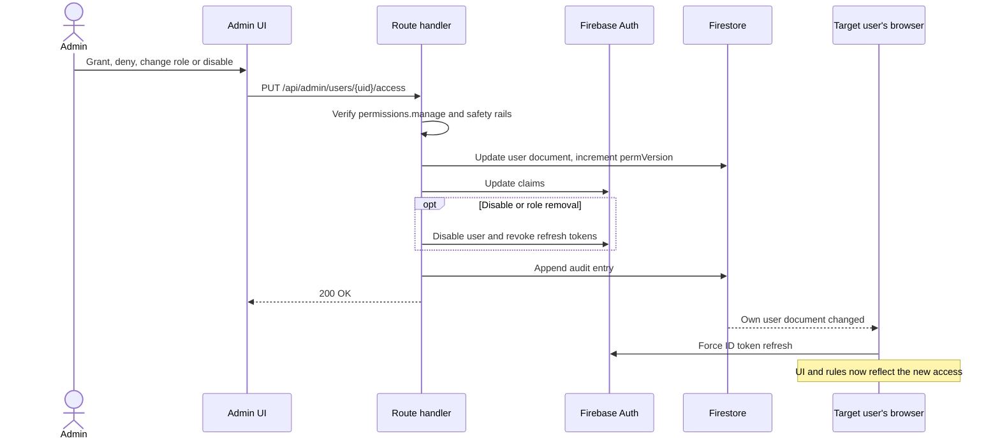

### 9.8 Appointment lifecycle and no-show (no scheduler)

No background job exists. A `BOOKED` appointment is **treated as NO_SHOW when read** once `slotStart + noShowGraceMinutes` has passed. The derived status is persisted by the **sweep** route handler, which is triggered when a doctor, receptionist or admin opens their dashboard. The slot is already in the past by then, so releasing it is a low-value operation; the status mainly matters for statistics and the queue.

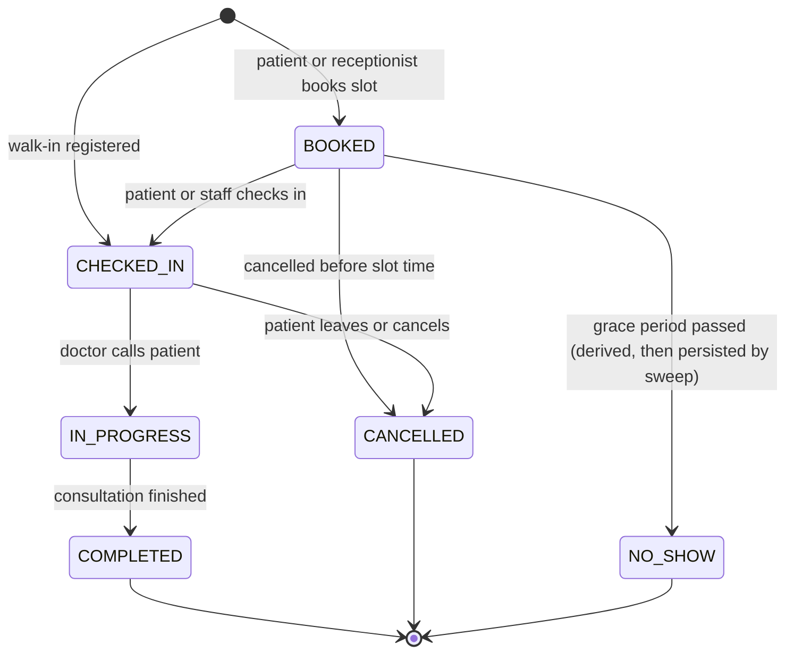

---

## 10. Key Design Decisions

| Decision | Reason |
|---|---|
| **No separate Express or Spring server** | A free-tier server that sleeps after inactivity breaks scheduled work and adds slow cold starts. Route handlers on Vercel need no always-on process. |
| **Direct Firestore reads, route-handler writes** | Real-time queue and simple reads for free; every write that affects ordering, access or audit is verified server-side. |
| **Store base score at booking, compute aging at read time** | Aging changes every minute; recomputing it in the browser avoids constant writes. Same idea as the master document. |
| **Server timestamp for check-in** | The client cannot move its own check-in time to gain or lose aging. |
| **Queue contains only CHECKED_IN appointments** | Priority applies among people actually present. |
| **No-show derived at read time, persisted by sweep** | Replaces the scheduler without background infrastructure. |
| **Slot reservation by Firestore transaction** | Replaces the SQL unique constraint; two simultaneous bookings of one slot cannot both succeed. |
| **Versioned scoring config document** | Tune without redeploying and reproduce any past score (NFR-05). |
| **Roles and permissions as custom claims, source of truth in Firestore** | Claims are fast for rules; the user document supports audit, UI and recovery. |
| **Role defaults plus per-user grant/deny, deny wins** | Gives the admin full, understandable control over each account. |
| **Account without a role has zero access** | Makes public sign-up harmless, so doctors and staff cannot self-register. |
| **Patients see queue position and wait estimate only** | Avoids exposing other patients' health data (also see decision 16-O5). |
| **One priority engine module for browser, server and simulation** | Experiments evaluate the real algorithm. |
| **Booking source recorded** (`ONLINE`, `RECEPTION`, `WALK_IN`) | Needed for reports and for analysing offline vs online patients. |

---

## 11. Security Architecture

| Area | Design |
|---|---|
| Passwords | Handled by Firebase Authentication (hashed and managed by Firebase). Minimum length and complexity enforced on the client and by Firebase settings. |
| Authentication | Firebase ID tokens. Route handlers verify every token with the Admin SDK (revocation check enabled). |
| Authorization | Claims plus ownership in Firestore rules; permission check plus user-document check in route handlers. |
| Rules posture | **Deny by default.** No client writes to appointments, scores, config, audit log, user documents or claims. |
| Account state | `active` flag checked in rules for protected data and in every handler; disable also revokes refresh tokens. |
| Admin SDK secret | Service-account key only in server environment variables (Vercel settings and local `.env.local`); never committed, never prefixed `NEXT_PUBLIC_`, never imported in client code. |
| Public web config | `NEXT_PUBLIC_FIREBASE_*` values are not secrets. Protection comes from rules, not from hiding them. |
| Input validation | Schema validation (for example Zod) on every handler body; client-side validation for usability only. |
| Abuse control | Rate limiting on public or expensive handlers is an open item (Section 15); Firebase Auth has its own throttling on login attempts. |
| Auth domains | Authorized domains in Firebase Auth limited to `localhost` and the Vercel domain(s). |
| Transport | HTTPS on Vercel and Firebase; local development over `localhost`. |
| Logging | No passwords, tokens or full symptom text in server logs. |
| Auditing | Overrides, config changes, symptom edits, user creation, role and permission changes and disables are appended to an audit log that clients cannot write or edit. |
| Data in experiments | Synthetic data only. No real patient data is used. |
| Disclaimer | The in-app disclaimer from the master document (Section 24) is shown on booking and queue pages. |

---

## 12. Environments and Deployment

### 12.1 One shared Firebase project

Local development and the Vercel deployment use **the same Firebase project** (same Auth users, same Firestore data). Only environment variables differ between the two runtimes.

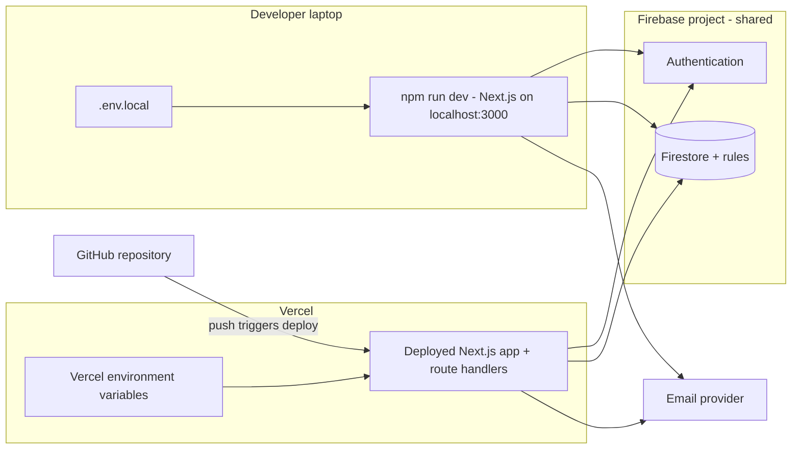

### 12.2 Environment variables (names provisional, final list in DOC_2)

| Variable | Used by | Secret? |
|---|---|---|
| `NEXT_PUBLIC_FIREBASE_API_KEY`, `..._AUTH_DOMAIN`, `..._PROJECT_ID`, `..._APP_ID`, etc. | Browser | No |
| `FIREBASE_ADMIN_PROJECT_ID`, `FIREBASE_ADMIN_CLIENT_EMAIL`, `FIREBASE_ADMIN_PRIVATE_KEY` | Route handlers | **Yes** |
| Email settings (host or API key, sender address) | Route handlers | **Yes** |
| `APP_BASE_URL` | Email links | No |

Local values live in `.env.local` (git-ignored). Production values are set in the Vercel project settings.

### 12.3 Consequences of sharing one project

| Effect | Handling |
|---|---|
| Local test data appears on the deployed site | Acceptable for a college project with synthetic data; use clearly labelled test accounts |
| A bad rules or config change affects live | Keep rules in the repository, review changes by pull request, and deploy them deliberately |
| Option to separate later | The same variable pattern supports adding a second Firebase project for development without code changes |

### 12.4 Hosting notes

- Route handlers that use the Admin SDK must run on the **Node.js runtime**, not the Edge runtime.
- Firebase and Vercel free plans have daily and per-function limits (Firestore read and write quotas, function duration). Real-time listeners and security-rule document lookups count towards reads. Check current limits in the official documentation before the demo (Section 15).
- Firestore database location is chosen once at creation; the choice is covered in DOC_2.

---

## 13. Technology Stack

| Layer | Technology | Purpose |
|---|---|---|
| Frontend framework | Next.js (App Router) with React | UI, routing, role-based pages |
| Language | JavaScript or TypeScript (to be decided in DOC_5) | Application code |
| Trusted server code | Next.js route handlers, Node.js runtime | Booking, overrides, user and permission management |
| Authentication | Firebase Authentication | Identity, login, password reset |
| Database | Cloud Firestore | Real-time document storage |
| Access control | Firestore security rules plus custom claims | Deny-by-default authorization |
| Privileged access | Firebase Admin SDK | Server-side Auth and Firestore operations |
| Validation | Zod (proposed) | Request body validation |
| Styling | Tailwind CSS or Bootstrap (open decision D2) | Responsive UI |
| i18n | English and Hindi resource files | Bilingual UI (F12) |
| Charts | Recharts or Chart.js | Dashboards and simulation graphs |
| Email | Provider to be chosen (Section 16) | Booking confirmation and cancellation |
| Testing | Jest or Vitest, plus API tests; Firebase rules tests | Engine, handlers, rules |
| Hosting | Vercel (app) and Firebase (data) | Deployment |
| Version control | Git and GitHub | Collaboration |
| Editor | VS Code | Development |

**Software prerequisites:** a current Node.js LTS (check the minimum for the chosen Next.js version), Git, a Google account for Firebase, a Vercel account linked to GitHub, Chrome or Firefox.

---

## 14. Non-Functional Requirements Mapping

| ID | Master requirement | Under the new architecture |
|---|---|---|
| NFR-01 | BCrypt and self-issued JWT | Firebase Authentication manages credentials and tokens; role checks in rules and handlers |
| NFR-02 | Patients see own data, doctors own queue | Enforced by security rules (ownership and claims) and by handlers |
| NFR-03 | Queue under 500 ms for 200 entries | Single indexed Firestore query plus local sorting; to be measured |
| NFR-04 | Responsive, booking under 2 minutes | Unchanged; covered in DOC_6 |
| NFR-05 | Score reproducible | Stored breakdown, config version and server check-in time |
| NFR-06 | Auditability | Append-only audit log written only by handlers; extended to user and permission changes |
| NFR-07 | 70% coverage on scoring and queue logic | Applies to the priority engine module and queue helpers |
| NFR-08 | JDK 17, MySQL 8, Node 18 | Reworded: runs on Windows, Linux and macOS with Node.js LTS and a Firebase project |
| NFR-09 | No duplicate slot booking | Firestore transaction in the booking handler; concurrency test required |
| NFR-10 | Seeded, reproducible simulation | Seeded pseudo-random generator in the simulation code |

---

## 15. Risks and Limitations

| Risk or limitation | Mitigation |
|---|---|
| Shared dev and live Firebase data | Test accounts, reviewed rules changes, optional second project later |
| Free-tier quotas (reads from listeners and rule lookups) | Narrow queries, limit listeners to the open page, minimise rule `get()` calls, monitor usage |
| Admin SDK key leak | Server-only env vars, git-ignore, never `NEXT_PUBLIC_`, rotate if exposed |
| Admin SDK bypasses rules, so a handler bug can expose data | Central helper for token, permission and active-user checks used by every handler; tests per handler |
| Permission changes lag until the token refreshes | `permVersion` listener, forced refresh, `active` check in rules for protected data |
| Route handler time limits on free hosting | All operations are short transactions; no long-running work |
| Public handlers can be abused | Only the registration completion handler is reachable by new accounts; add rate limiting and basic checks |
| Firestore has no joins | Denormalise fields needed by queue and history views (designed in DOC_3) |
| Receptionist handling patient data | Least-privilege defaults, no consultation notes, optional breakdown access by grant only |
| Simulation runs in browser or locally, not as a deployed service | Acceptable; it only needs the shared engine and exports CSV |
| Self-reported symptoms can be inaccurate | Unchanged from the master document: capped self-urgent points, doctor override |
| Rule-based score is not clinical triage | Unchanged: disclaimer, doctor decides, clinician review of rules |

---

## 16. Open Decisions

| # | Decision | Options | Status |
|---|---|---|---|
| D2 | Tailwind CSS or Bootstrap | Tailwind (proposed) or Bootstrap | Open (decide in DOC_5 and DOC_6) |
| O1 | JavaScript or TypeScript | TypeScript recommended for the shared engine and handlers | Open (DOC_5) |
| O2 | Email provider | SMTP via Nodemailer or a free-tier transactional service | Open (DOC_2) |
| O3 | Temporary password vs email setup link for new staff | Temporary password (as in master document) or setup link | Open; default is temporary password |
| O4 | Check the `active` flag from the user document inside rules | Yes for protected data (costs an extra read per evaluation) or claims only | Proposed: yes for protected data |
| O5 | Can patients see their own score breakdown? | The master document is inconsistent (permission matrix vs Section 9.4). This document assumes **position and wait estimate only** | Open; decide in DOC_6 |
| O6 | Patient email verification | Required or optional | Open |
| O7 | Receptionist visibility of score breakdown | Hidden by default, grantable | Proposed |
| O8 | Firestore location and Firebase plan | Chosen at project creation | Open (DOC_2) |
| D1, D6, D8 | Final scoring numbers, simulation distributions, target venue | Unchanged from the master document | Open |
| D5 | Simulation language | **Resolved:** JavaScript with the shared engine | Closed |
| D4 | Receptionist role | **Resolved:** separate Receptionist role | Closed |
| D7 | Polling vs real-time queue | **Resolved:** Firestore real-time listeners with local aging | Closed |

---

## 17. Changelog

| Version | Date | Author | Changes |
|---|---|---|---|
| 0.1 | 2026-10-25 | Team | First draft of the architecture on the Next.js and Firebase stack; Express removed; Receptionist role and per-user permission model added. |
| 0.2 | 2026-10-25 | Team | Aligned with DOC_3: patient position served by a read-only handler, staff-confirmed profile linking, patient self-edit limited to display name, added patient profile and link handlers. |
