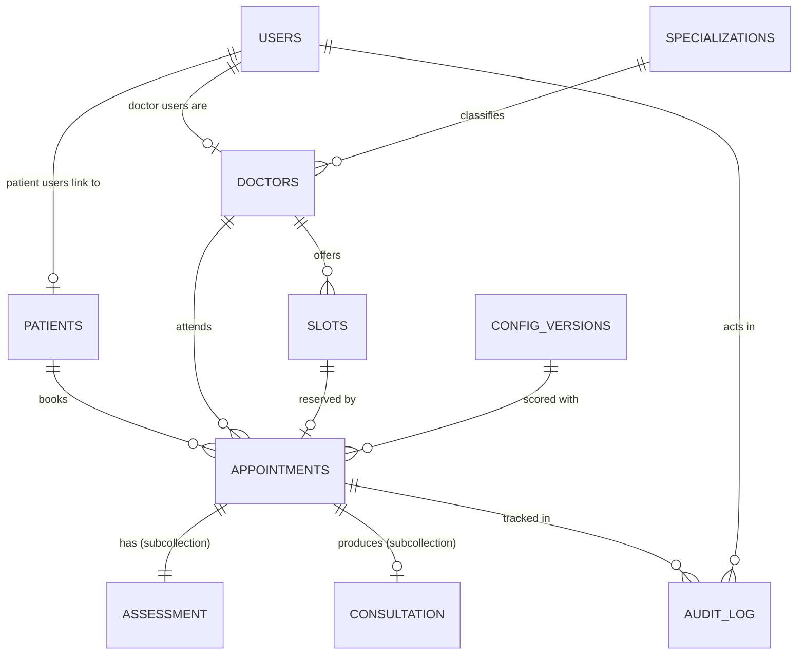

# DOC 3: Database Schema (Cloud Firestore)

> Firestore data model, permission keys, indexes and draft security rules for the **Smart Healthcare Appointment and Patient Prioritization System**. This document replaces Section 13 (MySQL tables) and the entity-relationship diagram of the master document.

| | |
|---|---|
| **Document** | DOC_3_DATABASE_SCHEMA |
| **Version** | 0.1 (Draft for review) |
| **Date** | 2026-10-25 |
| **Depends on** | DOC_1 System Architecture, DOC_2 Firebase Setup |
| **Used by** | DOC_4 API Specification, DOC_5 Frontend Architecture |

---

## Table of Contents

1. [Purpose and Scope](#1-purpose-and-scope)
2. [Design Principles](#2-design-principles)
3. [Collection Overview](#3-collection-overview)
4. [Conventions](#4-conventions)
5. [Enumerations](#5-enumerations)
6. [Permissions and Claims](#6-permissions-and-claims)
7. [Collection Details](#7-collection-details)
8. [Queue, Position and No-Show Logic](#8-queue-position-and-no-show-logic)
9. [Mapping from the Master Document Tables](#9-mapping-from-the-master-document-tables)
10. [Indexes and Query Map](#10-indexes-and-query-map)
11. [Security Rules (Draft)](#11-security-rules-draft)
12. [Seed Data](#12-seed-data)
13. [Data Lifecycle and Privacy](#13-data-lifecycle-and-privacy)
14. [Open Decisions](#14-open-decisions)
15. [Changelog](#15-changelog)

---

## 1. Purpose and Scope

This document defines **what is stored, where, and who can read or write it**: collections, field shapes, enumerations, the final permission key list, composite indexes, the screen-to-query map and the draft security rules.

It does not define endpoint contracts (DOC_4), Firebase console steps (DOC_2) or UI layout (DOC_5, DOC_6).

---

## 2. Design Principles

| # | Principle | Consequence |
|---|---|---|
| 1 | **Design for the queries, not for normalisation.** Firestore has no joins. | Fields needed by a screen are copied into the document that screen reads (Section 7.9). |
| 2 | **Security rules work per document, not per field.** | Anything that must be hidden from some readers lives in a **separate document or subcollection** (the `clinical` subcollection). |
| 3 | **Every write that affects ordering, access or audit is server-side.** | Rules deny all client writes except one narrow profile edit. |
| 4 | **Do not store what can be derived.** | Aging and final score are computed at read time; no-show is derived (DOC_1 Section 9.8). |
| 5 | **Server timestamps for anything time-sensitive.** | Check-in time cannot be set by a client. |
| 6 | **UTC timestamps plus a clinic-local `dateKey`.** | "Today's queue" is a simple equality query. |
| 7 | **Reproducibility.** | Each score stores the configuration version used and the component breakdown. |
| 8 | **Least privilege.** | The doctor never reads the patients collection; the receptionist never reads consultation notes. |

---

## 3. Collection Overview

```
users/{uid}
patients/{patientId}
specializations/{specializationId}
doctors/{doctorUid}
slots/{slotId}
appointments/{appointmentId}
   └─ clinical/assessment            (symptom form)
   └─ clinical/consultation          (doctor notes, prescription)
configVersions/{versionNumber}
meta/activeConfig                    (pointer to the active version)
meta/counters                        (patient code sequence; server-only)
auditLog/{entryId}
```



**Who touches what**

| Collection | Client read | Client write | Server write (route handlers) |
|---|---|---|---|
| `users` | Own document; `users.manage` reads all | None | Create, access changes |
| `patients` | Own profile; `patients.search` | Own `name` only | Create, link, edit phone |
| `specializations`, `doctors`, `slots` | Any active member | None | Admin and doctor-own slot management; booking updates slots |
| `appointments` | By ownership or queue permission | None | Booking, check-in, status changes, override |
| `appointments/.../clinical/*` | Restricted (Section 11) | None | Booking, symptom edits, consultation |
| `configVersions`, `meta/activeConfig` | Any active member | None | Config updates |
| `meta/counters` | None | None | Patient code sequence |
| `auditLog` | `audit.view` | None | Append only |

---

## 4. Conventions

| Topic | Convention |
|---|---|
| Field names | `camelCase` |
| Document IDs | Auto IDs, except where stated (`users` and `doctors` use the Auth UID; `slots` use a deterministic ID; `configVersions` use the version number as a string) |
| Timestamps | Firestore `Timestamp` in UTC (`createdAt`, `bookingTime`, `checkInTime`, ...) |
| `dateKey` | Clinic-local date as `"YYYY-MM-DD"` in **Asia/Kolkata**, computed on the server |
| Times of day | `"HH:mm"` strings in clinic-local time (slot display) next to UTC timestamps (slot logic) |
| Dates of birth | `"YYYY-MM-DD"` string |
| Phone numbers | Normalised to **E.164** (`"+919876543210"`). A 10-digit Indian number gets `+91` by default |
| Search helper | `nameLower` is `name` in lowercase, used for prefix search |
| Nullable references | Stored as explicit `null` (not omitted) so equality queries and rules behave predictably |
| Booleans | Positive names (`active`, `emergencyFlag`) |
| Empty values | Empty arrays `[]`, never `null`, for list fields |
| Schema changes | Add fields freely; never rename in place without a migration note in the changelog |

---

## 5. Enumerations

| Enum | Values |
|---|---|
| `role` | `patient`, `doctor`, `receptionist`, `admin` |
| `gender` | `MALE`, `FEMALE`, `OTHER` |
| `appointment.status` | `BOOKED`, `CHECKED_IN`, `IN_PROGRESS`, `COMPLETED`, `CANCELLED`, `NO_SHOW` |
| `appointment.type` | `ONLINE` (patient booked), `RECEPTION` (staff booked a slot), `WALK_IN` (no slot) |
| `slot.status` | `AVAILABLE`, `BOOKED`, `BLOCKED` |
| `severity` | `MILD`, `MODERATE`, `SEVERE`, `CRITICAL` (CRITICAL is never self-selected) |
| `onset` | `SUDDEN`, `GRADUAL` |
| `chiefComplaint` | `FEVER`, `COUGH`, `CHEST_PAIN`, `INJURY`, `STOMACH_PAIN`, `SKIN`, `OTHER` |
| `redFlag` codes | `CHEST_PAIN`, `SEVERE_BREATHING_DIFFICULTY`, `UNCONSCIOUS`, `SEVERE_BLEEDING`, `STROKE_SIGNS`, `SEIZURE`, `SEVERE_ALLERGIC_REACTION`, `SELF_HARM_THOUGHTS` |
| `patient.createdVia` | `SELF`, `RECEPTION`, `ADMIN` |
| `audit.action` | `USER_CREATED`, `ROLE_CHANGED`, `PERMISSION_GRANTED`, `PERMISSION_DENIED`, `PERMISSION_RESET`, `USER_DISABLED`, `USER_ENABLED`, `PATIENT_PROFILE_CREATED`, `PATIENT_LINKED`, `SYMPTOMS_EDITED`, `PRIORITY_OVERRIDE`, `APPOINTMENT_CANCELLED_ON_BEHALF`, `CONFIG_UPDATED`, `SEED_RUN` |

---

## 6. Permissions and Claims

This is the **final permission key list** and supersedes the draft list in DOC_1 Section 6.3.

### 6.1 Permission keys and role defaults

`Yes` = included in the role's default bundle. The admin can grant any key to an individual account or deny it (deny wins). Patient keys are scoped to the patient's **own** data in rules and handlers.

| Group | Key | Patient | Doctor | Receptionist | Admin |
|---|---|:--:|:--:|:--:|:--:|
| Users | `users.manage` | | | | Yes |
| Users | `permissions.manage` | | | | Yes |
| Catalogue | `doctors.manage` | | | | Yes |
| Catalogue | `specializations.manage` | | | | Yes |
| Catalogue | `slots.manage` | | | | Yes |
| Catalogue | `slots.manage_own` | | Yes | | |
| Patients | `patients.search` | | | Yes | Yes |
| Patients | `patients.create_profile` | | | Yes | Yes |
| Appointments (self) | `appointments.book_self` | Yes | | | |
| Appointments (self) | `appointments.cancel_self` | Yes | | | |
| Appointments (self) | `appointments.checkin_self` | Yes | | | |
| Appointments (self) | `appointments.edit_symptoms_self` | Yes | | | |
| Appointments (staff) | `appointments.book_for_patient` | | | Yes | Yes |
| Appointments (staff) | `appointments.cancel_for_patient` | | | Yes | Yes |
| Appointments (staff) | `appointments.checkin_for_patient` | | | Yes | Yes |
| Appointments (staff) | `appointments.edit_symptoms_for_patient` | | | Yes | Yes |
| Appointments (staff) | `appointments.register_walkin` | | | Yes | Yes |
| Queue | `queue.view_own` | | Yes | | |
| Queue | `queue.view_all` | | | Yes | Yes |
| Queue | `queue.view_breakdown` | | Yes | | Yes |
| Consultation | `consultation.manage` | | Yes | | |
| Priority | `priority.override` | | Yes | | Yes |
| Reports | `reports.view_own` | | Yes | | |
| Reports | `reports.view` | | | | Yes |
| Administration | `config.edit` | | | | Yes |
| Administration | `audit.view` | | | | Yes |
| Administration | `simulation.run` | | | | Yes |

Grantable examples: give a receptionist `reports.view`, `queue.view_breakdown` or `slots.manage`; deny a doctor `priority.override`; deny a patient `appointments.book_self` to block online booking for one account.

**Effective permissions** = `(roleDefaults + grants) - denies`. A disabled account (`active = false`) has none.

### 6.2 Custom claims format

Written by route handlers with the Admin SDK:

```json
{
  "role": "receptionist",
  "perms": ["patients.search", "patients.create_profile", "appointments.book_for_patient", "..."],
  "pv": 4
}
```

| Claim | Meaning |
|---|---|
| `role` | One of the four roles. **No `role` claim means no access.** |
| `perms` | The effective permission keys |
| `pv` | Permission version, equal to `users/{uid}.permVersion` |

**Size check:** Firebase limits custom claims to 1,000 bytes. The largest bundle (admin, 19 keys) is roughly 550 bytes. A unit test must assert that every effective permission set stays **under 900 bytes**; if grants ever push it over, switch to short codes (for example `qv_all`) without changing the key names used elsewhere.

### 6.3 Role defaults live in code

`ROLE_DEFAULTS` is one constants module shared by the seed script, route handlers and UI. The same module exports the permission keys, so spelling mistakes fail at compile time.

---

## 7. Collection Details

### 7.1 `users/{uid}`

One document per Firebase Auth account. Only route handlers write it.

| Field | Type | Notes |
|---|---|---|
| `uid` | string | Same as the document ID |
| `email` | string | |
| `displayName` | string | |
| `role` | enum | Mirrors the claim |
| `grants` | string[] | Extra permissions given by an admin |
| `denies` | string[] | Permissions removed by an admin (deny wins) |
| `effectivePerms` | string[] | Computed copy, also placed in the claims |
| `active` | boolean | `false` = disabled |
| `mustChangePassword` | boolean | `true` until the first password change |
| `permVersion` | number | Incremented on every access change |
| `patientId` | string or null | Set for patient users |
| `createdAt`, `updatedAt` | Timestamp | |
| `createdByUid` | string or null | `null` for self-registered patients and the seed admin |
| `disabledAt`, `disabledReason` | Timestamp, string or null | |

```json
{
  "uid": "u_8f2k1",
  "email": "reception1.demo@example.com",
  "displayName": "Demo Receptionist",
  "role": "receptionist",
  "grants": ["reports.view"],
  "denies": [],
  "effectivePerms": ["patients.search", "patients.create_profile", "appointments.book_for_patient", "reports.view"],
  "active": true,
  "mustChangePassword": true,
  "permVersion": 2,
  "patientId": null
}
```

### 7.2 `patients/{patientId}`

Patients with or without a login. A walk-in profile simply has `uid = null`.

| Field | Type | Notes |
|---|---|---|
| `uid` | string or null | Auth UID of the patient user, or `null` for offline profiles |
| `patientCode` | string | Short code such as `P-000123`, from the counter in `meta/counters`. Helps desk lookup |
| `name`, `nameLower` | string | `nameLower` is kept in sync (rules enforce it on self-edits) |
| `phone` | string | E.164. **Not unique**: family members may share a number |
| `dob` | string | `YYYY-MM-DD`. Age is derived from it |
| `gender` | enum | |
| `bloodGroup` | string or null | Optional |
| `abhaId` | string or null | Optional (F13); stored only, no integration |
| `createdVia` | enum | `SELF`, `RECEPTION`, `ADMIN` |
| `createdByUid` | string or null | |
| `mergedInto` | string or null | Set when an offline profile is merged into a registered patient (see below) |
| `linkedAt`, `linkedByUid` | Timestamp, string or null | |
| `createdAt`, `updatedAt` | Timestamp | |

```json
{
  "uid": null,
  "patientCode": "P-000123",
  "name": "Ramesh Kumar",
  "nameLower": "ramesh kumar",
  "phone": "+919800000000",
  "dob": "1958-04-12",
  "gender": "MALE",
  "createdVia": "RECEPTION",
  "mergedInto": null
}
```

**Linking an offline profile to a registered account.** The master document suggested matching by phone number. A phone number is **not proof of identity** (anyone could register with someone else's number, and no OTP check exists in this phase), so linking is **staff-confirmed**:

1. The patient registers online and gets their own `patients` document.
2. At the desk, a staff member with `patients.create_profile` finds the old offline profile and the new one, confirms identity, and triggers a link.
3. A handler repoints the offline profile's appointments to the registered patient (`patientId`, `patientUid`), sets `mergedInto` on the offline profile and writes a `PATIENT_LINKED` audit entry.
4. Profiles with `mergedInto != null` are hidden from search.

### 7.3 `specializations/{specializationId}`

| Field | Type | Notes |
|---|---|---|
| `name` | string | Unique by convention (checked by the handler) |
| `nameHi` | string or null | Hindi label (F12) |
| `active` | boolean | Deactivate instead of deleting |
| `createdAt`, `updatedAt` | Timestamp | |

### 7.4 `doctors/{doctorUid}`

The document ID **is the doctor's Auth UID**, so rules compare it directly with `request.auth.uid`.

| Field | Type | Notes |
|---|---|---|
| `uid` | string | Same as ID |
| `name` | string | |
| `specializationId`, `specializationName` | string | Name is copied for display |
| `qualification` | string | |
| `avgConsultMinutes` | number | Feeds the wait estimate |
| `active` | boolean | |
| `createdAt`, `updatedAt` | Timestamp | |

### 7.5 `slots/{slotId}`

**Deterministic ID:** `{doctorUid}_{dateKey}_{HHmm}`, for example `u_d41_2026-11-05_1030`. A duplicate slot is impossible because the same ID cannot be created twice.

| Field | Type | Notes |
|---|---|---|
| `doctorId` | string | Doctor UID |
| `dateKey` | string | `YYYY-MM-DD` |
| `startTime`, `endTime` | string | `HH:mm` |
| `startAt`, `endAt` | Timestamp | UTC; used for ordering and no-show checks |
| `status` | enum | `AVAILABLE`, `BOOKED`, `BLOCKED` |
| `appointmentId` | string or null | Set when booked |
| `createdByUid` | string | |
| `createdAt` | Timestamp | |

Double booking is prevented by a **Firestore transaction** in the booking handler: read the slot, require `AVAILABLE`, then write the slot and the new appointment together.

### 7.6 `appointments/{appointmentId}`

The queue-facing document. It contains **no symptom text and no notes**.

| Field | Type | Notes |
|---|---|---|
| `patientId` | string | Patients document ID |
| `patientUid` | string or null | Used by rules for patient ownership |
| `patientName` | string | Copied at booking |
| `patientAge` | number | Age in years at booking |
| `doctorId`, `doctorName`, `specializationName` | string | Copied for display |
| `slotId` | string or null | `null` for walk-ins |
| `dateKey` | string | Clinic-local date of the appointment |
| `scheduledStartAt` | Timestamp or null | From the slot; `null` for walk-ins |
| `type` | enum | `ONLINE`, `RECEPTION`, `WALK_IN` |
| `bookedByUid`, `bookedByRole` | string | Who made the booking |
| `status` | enum | See Section 5 |
| `bookingTime` | Timestamp | Server time |
| `checkInTime` | Timestamp or null | **Server time**; starts the aging clock |
| `startTime`, `endTime` | Timestamp or null | Consultation start and end |
| `tieBreakAt` | Timestamp | Queue tie-breaker: `bookingTime`, or `checkInTime` for walk-ins |
| `severityEffective` | enum | After the red-flag rule |
| `severityPts`, `agePts`, `urgencyPts` | number | Components of the stored score |
| `baseScore` | number | Sum with weights applied |
| `emergencyFlag` | boolean | A red flag was selected |
| `manualAdjustment` | number | Default `0` |
| `overrideReason` | string or null | Required when `manualAdjustment` changes |
| `overriddenByUid`, `overriddenAt` | string, Timestamp or null | |
| `configVersion` | number | Config used for the base score |
| `cancelledAt`, `cancelledByUid`, `cancelReason` | Timestamp, string or null | |
| `noShowMarkedAt` | Timestamp or null | Set by the sweep |

```json
{
  "patientId": "p_91xa",
  "patientUid": "u_p77",
  "patientName": "R. Devi",
  "patientAge": 72,
  "doctorId": "u_d41",
  "doctorName": "Dr. Demo Sharma",
  "specializationName": "General Medicine",
  "slotId": "u_d41_2026-11-05_1030",
  "dateKey": "2026-11-05",
  "type": "ONLINE",
  "bookedByUid": "u_p77",
  "bookedByRole": "patient",
  "status": "CHECKED_IN",
  "checkInTime": "2026-11-05T10:02:00+05:30",
  "severityEffective": "SEVERE",
  "severityPts": 60, "agePts": 15, "urgencyPts": 15,
  "baseScore": 90,
  "emergencyFlag": false,
  "manualAdjustment": 0,
  "overrideReason": null,
  "configVersion": 1
}
```

**Scores are queue data.** Because security rules are per document, anyone allowed to read the queue (doctor, receptionist with `queue.view_all`, admin) can technically read these numeric score fields. `queue.view_breakdown` controls whether the **UI** shows the component breakdown. The numbers are derived values and do not contain symptom details, which sit in the protected `clinical` subcollection. If a stricter split is wanted, the score fields can move to a doctor-only document (open decision O3).

### 7.7 `appointments/{appointmentId}/clinical/assessment`

The symptom form. Created at booking, editable until check-in.

| Field | Type | Notes |
|---|---|---|
| `chiefComplaint` | enum | |
| `symptoms` | string[] | Checklist codes, including red-flag items |
| `notes` | string | Free text, length-limited (for example 500 characters) |
| `severitySelf` | enum | `MILD`, `MODERATE` or `SEVERE` only |
| `onset` | enum | |
| `durationHours` | number | Whole number, zero or more |
| `selfUrgent` | boolean | |
| `redFlags` | string[] | Derived from the checklist |
| `enteredByUid`, `enteredByRole` | string | A receptionist may enter it for the patient |
| `updatedAt` | Timestamp | |

### 7.8 `appointments/{appointmentId}/clinical/consultation`

| Field | Type | Notes |
|---|---|---|
| `notes` | string | Doctor's notes |
| `prescription` | string | |
| `doctorUid` | string | |
| `completedAt` | Timestamp | |

Readable by the assigned doctor and (see open decision O4) by the owning patient. Never by the receptionist. Not readable by the admin by default.

### 7.9 Denormalised fields and how they stay correct

| Copied field | Copied into | Rule |
|---|---|---|
| Patient name, age | `appointments` | A snapshot at booking. Later profile edits do not rewrite old appointments |
| Doctor name, specialization name | `appointments` | A snapshot. Past records keep the name used at the time |
| Slot start time | `appointments.scheduledStartAt` | Slots are not edited after booking (cancel and recreate instead) |
| Effective permissions | `users.effectivePerms` and claims | Rewritten together by the access handler |

### 7.10 `configVersions/{versionNumber}` and `meta/activeConfig`

One **immutable** document per configuration version (ID `"1"`, `"2"`, ...). A change creates a new document and moves the pointer; nothing is edited in place.

| Field | Type | Notes |
|---|---|---|
| `version` | number | |
| `params` | map | See the default below |
| `changeNote` | string | Why it changed |
| `createdAt`, `createdByUid` | Timestamp, string | |

`meta/activeConfig`: `{ version, updatedAt, updatedByUid }`. Readers fetch the pointer, then the version document (no `active == true` query).

**Default `params` (version 1, initial values from the master document, tunable):**

```json
{
  "weights": { "w1": 1.0, "w2": 1.0, "w3": 1.0 },
  "severityPoints": { "MILD": 10, "MODERATE": 30, "SEVERE": 60, "CRITICAL": 100 },
  "agePoints": [
    { "min": 0,  "max": 0,   "points": 25 },
    { "min": 1,  "max": 5,   "points": 20 },
    { "min": 6,  "max": 17,  "points": 5 },
    { "min": 18, "max": 59,  "points": 0 },
    { "min": 60, "max": 74,  "points": 15 },
    { "min": 75, "max": 150, "points": 25 }
  ],
  "urgencyPoints": { "suddenOnset": 10, "durationUnder24h": 5, "selfUrgent": 10 },
  "aging": { "divisorMinutes": 10, "cap": 30 },
  "noShowGraceMinutes": 20,
  "redFlags": ["CHEST_PAIN", "SEVERE_BREATHING_DIFFICULTY", "UNCONSCIOUS", "SEVERE_BLEEDING",
               "STROKE_SIGNS", "SEIZURE", "SEVERE_ALLERGIC_REACTION", "SELF_HARM_THOUGHTS"]
}
```

**Note on aging and versions:** the **base score** is stored with the version used at booking. **Aging is computed live** with the currently active configuration, so changing the aging divisor or cap affects people already waiting. Each config change is audited so experiments can state which parameters applied.

### 7.11 `auditLog/{entryId}`

Append-only. Written only by route handlers. No handler ever updates or deletes an entry.

| Field | Type | Notes |
|---|---|---|
| `timestamp` | Timestamp | Server time |
| `actorUid`, `actorRole` | string | Who did it |
| `action` | enum | Section 5 |
| `targetType` | string | `USER`, `PATIENT`, `APPOINTMENT`, `CONFIG`, `SLOT` |
| `targetId` | string | |
| `appointmentId` | string or null | For appointment-related entries |
| `oldValue`, `newValue` | map, string or null | Keep small; never include symptom text |
| `reason` | string or null | Mandatory for overrides |

```json
{
  "actorUid": "u_d41",
  "actorRole": "doctor",
  "action": "PRIORITY_OVERRIDE",
  "targetType": "APPOINTMENT",
  "targetId": "a_55b2",
  "appointmentId": "a_55b2",
  "oldValue": { "manualAdjustment": 0 },
  "newValue": { "manualAdjustment": 20 },
  "reason": "Patient became breathless in waiting area"
}
```

### 7.12 `meta/counters`

Server-only. Holds the patient code sequence (`patientSeq`), incremented inside a transaction when a patient profile is created.

---

## 8. Queue, Position and No-Show Logic

### 8.1 Doctor's live queue

1. Listener: `appointments` where `doctorId == uid`, `dateKey == today`, `status in [CHECKED_IN, IN_PROGRESS]`.
2. The browser reads the active configuration once.
3. `computeFinal` and `sortQueue` (the shared engine, DOC_1 Section 8) run on every snapshot and on a 30 to 60 second timer.
4. The `IN_PROGRESS` entry is shown first as "current"; the rest are sorted by final score descending, then `tieBreakAt` ascending.

### 8.2 Receptionist and admin overview

The same query without the `doctorId` filter (or per selected doctor), plus the day's `BOOKED` appointments for check-in. Requires `queue.view_all`.

### 8.3 Patient position and estimated wait

A patient may only read their own appointment, so they **cannot compute their position from the data they can read**. This is a read-only server operation:

`GET /api/appointments/{id}/queue-status` (details in DOC_4):

1. Verify the token and that the appointment belongs to the caller.
2. Read the doctor's `CHECKED_IN` appointments for the date and compute the order with the shared engine.
3. Return `position`, `patientsAhead` and `estimatedWaitMinutes = patientsAhead × avgConsultMinutes` (a simple estimate; refined later if needed).
4. The patient page polls it every 30 seconds while open. Nothing about other patients is returned.

### 8.4 Derived no-show

An appointment with `status == BOOKED` and `scheduledStartAt + noShowGraceMinutes < now` is **displayed as NO_SHOW**. The `sweep` handler persists the status (and sets `noShowMarkedAt`) when a doctor, receptionist or admin opens their dashboard, using the query `appointments` where `dateKey == today` and `status == BOOKED`.

### 8.5 Doctor and admin statistics

Counts and waits are computed from completed appointments using `startTime - checkInTime`. Doctors read only their own appointments (`reports.view_own`); admins use `reports.view`. Heavy aggregation for the paper is done by the simulation and exports, not by live dashboards.

---

## 9. Mapping from the Master Document Tables

| Master document (MySQL) | Firestore |
|---|---|
| `users` | `users/{uid}` plus Firebase Auth (password and login handled by Auth) |
| `patients` | `patients/{patientId}` (may exist without a login) |
| `specializations` | `specializations/{id}` |
| `doctors` | `doctors/{uid}` |
| `doctor_slots` | `slots/{slotId}` (deterministic ID) |
| `appointments` | `appointments/{id}` (queue-facing fields only) |
| `symptom_assessments` | `appointments/{id}/clinical/assessment` |
| `priority_scores` | Merged into `appointments` (score fields); breakdown is the component fields |
| `consultation_notes` | `appointments/{id}/clinical/consultation` |
| `system_config` | `configVersions/{n}` plus `meta/activeConfig` |
| `audit_log` | `auditLog/{id}` |
| `notifications` | **Dropped** (no reminders or scheduler in this phase) |
| Foreign keys and unique constraints | Document references, deterministic IDs and transactions |

---

## 10. Indexes and Query Map

Single-field indexes are automatic. **Queries that use only equality filters** (including `in` on one field) are served by merging them and need no composite index. A composite index is needed when a query adds `orderBy` or a range on another field. Firestore shows a link to create any index that is missing.

### 10.1 Screen-to-query map

| Screen | Query | Index |
|---|---|---|
| Find doctor | `doctors` where `specializationId == X` and `active == true` | Automatic |
| Slot picker | `slots` where `doctorId == X`, `dateKey == D`, `status == AVAILABLE`, order by `startAt` | **Composite 1** |
| Patient: my appointments | `appointments` where `patientUid == uid`, order by `bookingTime` desc | **Composite 2** |
| Doctor: today's queue | `appointments` where `doctorId == uid`, `dateKey == today`, `status in [...]` | Automatic |
| Doctor: my slots | `slots` where `doctorId == uid`, `dateKey == D`, order by `startAt` | **Composite 3** |
| Reception: today's bookings | `appointments` where `dateKey == today` and `status == BOOKED` | Automatic |
| Reception: patient search by phone | `patients` where `phone == X` and `mergedInto == null` | Automatic |
| Reception: patient search by name | `patients` where `nameLower >= q` and `nameLower <= q + "\uf8ff"` | Automatic |
| Reception: patient search by code | `patients` where `patientCode == X` | Automatic |
| Admin: appointments by date range | `appointments` where `status == X` and `dateKey` between A and B | **Composite 4** |
| Doctor stats | `appointments` where `doctorId == uid` and `dateKey` between A and B | **Composite 5** |
| Admin: audit log, filtered by actor | `auditLog` where `actorUid == X`, order by `timestamp` desc | **Composite 6** |
| Admin: audit log, filtered by action | `auditLog` where `action == X`, order by `timestamp` desc | **Composite 7** |
| Admin: audit log, by appointment | `auditLog` where `appointmentId == X`, order by `timestamp` desc | **Composite 8** |
| Admin: audit log, unfiltered | `auditLog` order by `timestamp` desc | Automatic |
| No-show sweep (server) | `appointments` where `dateKey == today` and `status == BOOKED` | Automatic |

Name search is **prefix only**; Firestore has no full-text search. The phone number and patient code are the dependable lookup keys at the desk.

### 10.2 `firestore.indexes.json`

```json
{
  "indexes": [
    {
      "collectionGroup": "slots",
      "queryScope": "COLLECTION",
      "fields": [
        { "fieldPath": "doctorId", "order": "ASCENDING" },
        { "fieldPath": "dateKey", "order": "ASCENDING" },
        { "fieldPath": "status", "order": "ASCENDING" },
        { "fieldPath": "startAt", "order": "ASCENDING" }
      ]
    },
    {
      "collectionGroup": "appointments",
      "queryScope": "COLLECTION",
      "fields": [
        { "fieldPath": "patientUid", "order": "ASCENDING" },
        { "fieldPath": "bookingTime", "order": "DESCENDING" }
      ]
    },
    {
      "collectionGroup": "slots",
      "queryScope": "COLLECTION",
      "fields": [
        { "fieldPath": "doctorId", "order": "ASCENDING" },
        { "fieldPath": "dateKey", "order": "ASCENDING" },
        { "fieldPath": "startAt", "order": "ASCENDING" }
      ]
    },
    {
      "collectionGroup": "appointments",
      "queryScope": "COLLECTION",
      "fields": [
        { "fieldPath": "status", "order": "ASCENDING" },
        { "fieldPath": "dateKey", "order": "ASCENDING" }
      ]
    },
    {
      "collectionGroup": "appointments",
      "queryScope": "COLLECTION",
      "fields": [
        { "fieldPath": "doctorId", "order": "ASCENDING" },
        { "fieldPath": "dateKey", "order": "ASCENDING" }
      ]
    },
    {
      "collectionGroup": "auditLog",
      "queryScope": "COLLECTION",
      "fields": [
        { "fieldPath": "actorUid", "order": "ASCENDING" },
        { "fieldPath": "timestamp", "order": "DESCENDING" }
      ]
    },
    {
      "collectionGroup": "auditLog",
      "queryScope": "COLLECTION",
      "fields": [
        { "fieldPath": "action", "order": "ASCENDING" },
        { "fieldPath": "timestamp", "order": "DESCENDING" }
      ]
    },
    {
      "collectionGroup": "auditLog",
      "queryScope": "COLLECTION",
      "fields": [
        { "fieldPath": "appointmentId", "order": "ASCENDING" },
        { "fieldPath": "timestamp", "order": "DESCENDING" }
      ]
    }
  ],
  "fieldOverrides": []
}
```

Treat this as the starting set. When a screen's query is finalised in DOC_5 and the app reports another missing index, add it here so it lives in the repository.

---

## 11. Security Rules (Draft)

Posture: **deny by default**. No client writes except one narrow patient name edit. Role and permissions come from custom claims; the `active` flag is checked from the user document.

```
rules_version = '2';
service cloud.firestore {
  match /databases/{database}/documents {

    // ---------- helpers ----------
    function signedIn() {
      return request.auth != null;
    }

    function hasRole() {
      return signedIn()
        && 'role' in request.auth.token
        && request.auth.token.role in ['patient', 'doctor', 'receptionist', 'admin'];
    }

    function can(p) {
      return hasRole() && 'perms' in request.auth.token && p in request.auth.token.perms;
    }

    function isActive() {
      return get(/databases/$(database)/documents/users/$(request.auth.uid)).data.active == true;
    }

    // signed in, has a role claim, and the account is enabled
    function isMember() {
      return hasRole() && isActive();
    }

    function appt(id) {
      return get(/databases/$(database)/documents/appointments/$(id)).data;
    }

    // ---------- users ----------
    match /users/{uid} {
      allow read: if signedIn()
        && (request.auth.uid == uid || (can('users.manage') && isActive()));
      allow write: if false;
    }

    // ---------- patients ----------
    match /patients/{patientId} {
      allow read: if isMember()
        && (resource.data.uid == request.auth.uid || can('patients.search'));

      // a patient may edit only their own display name
      allow update: if isMember()
        && resource.data.uid == request.auth.uid
        && request.resource.data.diff(resource.data).affectedKeys()
             .hasOnly(['name', 'nameLower', 'updatedAt'])
        && request.resource.data.nameLower == request.resource.data.name.lower()
        && request.resource.data.updatedAt == request.time;

      allow create, delete: if false;
    }

    // ---------- reference data (read-only for members) ----------
    match /specializations/{id} {
      allow read: if isMember();
      allow write: if false;
    }
    match /doctors/{id} {
      allow read: if isMember();
      allow write: if false;
    }
    match /slots/{id} {
      allow read: if isMember();
      allow write: if false;
    }
    match /configVersions/{id} {
      allow read: if isMember();
      allow write: if false;
    }
    match /meta/activeConfig {
      allow read: if isMember();
      allow write: if false;
    }

    // ---------- appointments ----------
    match /appointments/{appointmentId} {
      allow read: if isMember() && (
        resource.data.patientUid == request.auth.uid
        || (can('queue.view_own') && resource.data.doctorId == request.auth.uid)
        || can('queue.view_all')
      );
      allow write: if false;

      // symptom form
      match /clinical/assessment {
        allow read: if isMember() && (
          appt(appointmentId).patientUid == request.auth.uid
          || (can('queue.view_own') && appt(appointmentId).doctorId == request.auth.uid)
          || can('appointments.edit_symptoms_for_patient')
        );
        allow write: if false;
      }

      // doctor notes (never the receptionist; admin not included by default)
      match /clinical/consultation {
        allow read: if isMember() && (
          (can('consultation.manage') && appt(appointmentId).doctorId == request.auth.uid)
          || appt(appointmentId).patientUid == request.auth.uid
        );
        allow write: if false;
      }
    }

    // ---------- audit log ----------
    match /auditLog/{entryId} {
      allow read: if isMember() && can('audit.view');
      allow write: if false;
    }

    // ---------- everything else ----------
    match /{document=**} {
      allow read, write: if false;
    }
  }
}
```

**Notes on these rules**

| Topic | Detail |
|---|---|
| Cost | `isActive()` adds a billed read of the user document per rule evaluation; clinical documents add one more read of the parent appointment. Stay within the limit on document-access calls per request |
| Query shape | Rules must be provable from the query filters. A patient lists appointments with `where patientUid == uid`; a doctor with `where doctorId == uid`. Other shapes are rejected |
| Role-less accounts | Fail `hasRole()` on every rule, so a sign-up outside the registration flow reads nothing |
| Disabled accounts | `isActive()` blocks reads even while an old token is still valid (DOC_1 Section 6.5) |
| Admin SDK | Bypasses all rules; every route handler enforces its own token, permission and active-user checks |
| Testing | Cover each rule with allowed and denied cases (patient vs other patient, receptionist vs consultation notes, role-less account, disabled account) |

---

## 12. Seed Data

Created by the seed script (DOC_2 Section 11). All demo data is **fictional** and clearly marked (`*.demo@example.com` addresses).

| Data | Content |
|---|---|
| First admin | One account from the seed variables, `mustChangePassword = true` |
| Configuration | Version 1 (Section 7.10) and the `meta/activeConfig` pointer |
| Counters | `meta/counters` with `patientSeq = 0` |
| Specializations | For example General Medicine, Paediatrics, Orthopaedics, Dermatology, ENT, Gynaecology (English and Hindi names) |
| Demo doctors | 5 accounts across the specializations, with `avgConsultMinutes` of 10 to 15 |
| Demo receptionist | 1 account |
| Demo patients | A handful of registered patients and offline profiles covering the age bands and the worked examples in the master document |
| Slots | Next 7 days, morning and afternoon blocks, 15-minute slots |
| Demo passwords | Generated randomly and printed once by the script; never hard-coded |
| Cleanup | A flag or script to remove demo data before any real use |

---

## 13. Data Lifecycle and Privacy

| Topic | Decision |
|---|---|
| Data in this project | **Synthetic only.** No real patient data |
| Sensitive fields | Symptoms and consultation notes are isolated in the `clinical` subcollection; audit entries never contain symptom text |
| Emails | Contain appointment time and doctor only, never symptoms or scores |
| Deletion | Cancel, deactivate and disable instead of deleting; the audit log is never deleted |
| Retention | Not defined for the demo; a retention rule is a future item |
| Real-world use | Would require ethics approval and review under India's Digital Personal Data Protection Act, 2023 (as noted in the master document) |
| Backups | Firestore export on the free plan is limited; for the demo, the seed script recreates the data |

---

## 14. Open Decisions

| # | Decision | Proposal | Status |
|---|---|---|---|
| O1 | Privileged-user login auditing (master document Section 16) | Needs an extra client call to a handler after login, since there is no login hook on the free plan. Optional | Open |
| O2 | Offline profile linking | Staff-confirmed merge (Section 7.2) rather than automatic phone matching | Proposed |
| O3 | Strict hiding of scores from the receptionist | Currently UI-only; a doctor-only score document would enforce it in rules at the cost of extra reads | Open |
| O4 | Can a patient read their own consultation notes and prescription? | Yes, read-only (as in the rules draft) | Open |
| O5 | Admin access to consultation notes | No by default; grantable only if a future key is added | Open |
| O6 | Patient score visibility | Position and estimated wait only (DOC_1 O5) | Open |
| O7 | Patient code format | `P-000123` sequential | Proposed |
| O8 | Slot length and clinic hours for seed data | 15 minutes, 09:00 to 13:00 and 14:00 to 17:00 | Proposed |

---

## 15. Changelog

| Version | Date | Author | Changes |
|---|---|---|---|
| 0.1 | 2026-10-25 | Team | First draft of the Firestore schema, final permission keys, indexes and draft security rules. |
