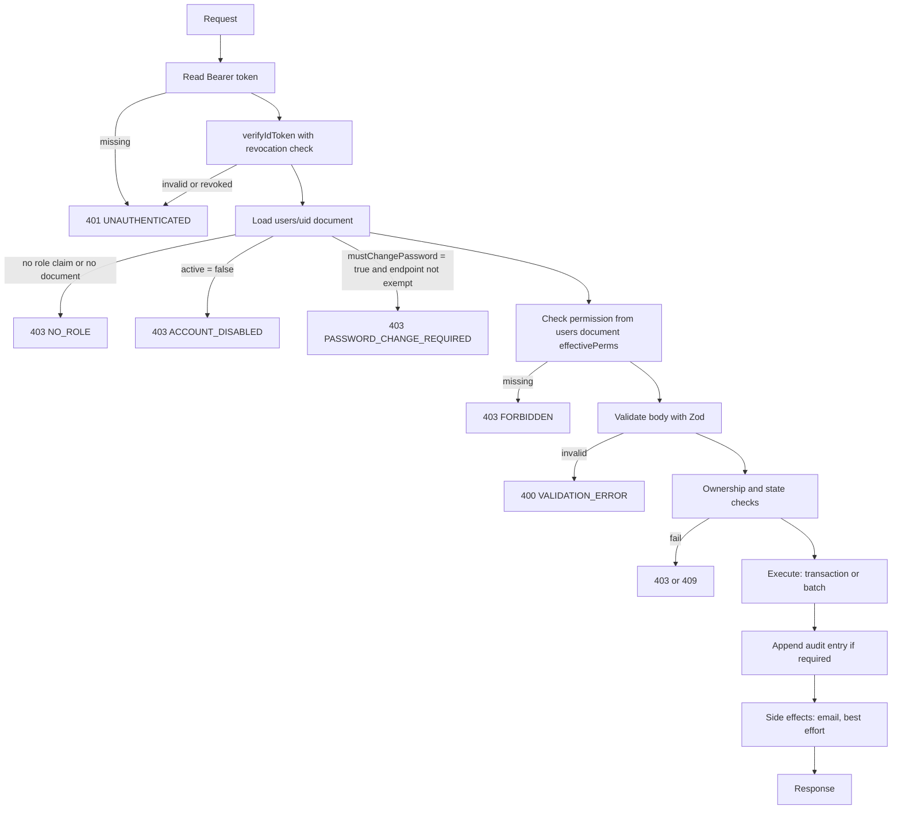

# DOC 4: API Specification (Next.js Route Handlers)

> Contract for the **trusted server operations** of the **Smart Healthcare Appointment and Patient Prioritization System**. There is no separate Express or Spring server: every endpoint below is a Next.js route handler running on the Node.js runtime with the Firebase Admin SDK. Reads that are safe for the browser go directly to Firestore and are listed in Section 10, not here.

| | |
|---|---|
| **Document** | DOC_4_API_SPECIFICATION |
| **Version** | 0.1 (Draft for review) |
| **Date** | 2026-10-26 |
| **Depends on** | DOC_1 System Architecture, DOC_2 Firebase Setup, DOC_3 Database Schema |
| **Used by** | DOC_5 Frontend Architecture, DOC_7 Task Tracker |

---

## Table of Contents

1. [Purpose and Scope](#1-purpose-and-scope)
2. [Conventions](#2-conventions)
3. [Handler Pipeline and Authorization](#3-handler-pipeline-and-authorization)
4. [Endpoint Summary](#4-endpoint-summary)
5. [Endpoint Details](#5-endpoint-details)
6. [Error Codes](#6-error-codes)
7. [Audit Mapping](#7-audit-mapping)
8. [Side Effects: Email](#8-side-effects-email)
9. [Concurrency and Idempotency](#9-concurrency-and-idempotency)
10. [Operations Done Directly in Firestore](#10-operations-done-directly-in-firestore)
11. [Code Structure](#11-code-structure)
12. [Testing Checklist](#12-testing-checklist)
13. [Open Decisions](#13-open-decisions)
14. [Changelog](#14-changelog)

---

## 1. Purpose and Scope

This document defines, for each route handler: who may call it, the request and response shapes, validation rules, state rules, errors, audit entries and side effects.

It replaces the REST API section and Swagger plan of the master document. Endpoints that existed only because of the Java backend (login, token refresh, plain CRUD on tables) are gone: Firebase handles login, and Firestore handles plain reads.

**Naming reminder:** field names, enums and permission keys are those defined in DOC_3.

---

## 2. Conventions

| Topic | Convention |
|---|---|
| Base path | `/api` (same origin as the Next.js app, so no CORS configuration) |
| Versioning | None for the MVP (the API is private to this app) |
| Format | JSON request and response bodies, `Content-Type: application/json` |
| Authentication | `Authorization: Bearer <Firebase ID token>` on every endpoint except `GET /api/health` |
| Runtime | Every handler exports `runtime = "nodejs"` and `dynamic = "force-dynamic"` |
| Timestamps in responses | ISO 8601 strings in UTC (for example `2026-11-05T04:32:00.000Z`) |
| Dates | `dateKey` as `YYYY-MM-DD` (Asia/Kolkata) |
| Request IDs | Optional `X-Request-Id` header is echoed back and written to server logs |
| Methods | `POST` creates or triggers, `PUT` changes state or fields, `GET` is read-only |
| Server decides | The server ignores any client-supplied score, role, status, timestamp or `bookedBy` field |

**Success envelope**

```json
{ "data": { "...": "..." } }
```

**Error envelope**

```json
{
  "error": {
    "code": "SLOT_UNAVAILABLE",
    "message": "This slot was just booked by someone else. Please choose another.",
    "details": []
  }
}
```

`details` is used for validation errors: a list of `{ "field": "assessment.severitySelf", "issue": "Required" }`.

**HTTP status codes**

| Status | Use |
|---|---|
| 200 | Success with a body |
| 201 | Resource created |
| 400 | Validation error or malformed request |
| 401 | Missing, invalid, expired or revoked token |
| 403 | Authenticated but not allowed (no role, missing permission, disabled account, password change required, not the owner) |
| 404 | Resource not found (or hidden from this caller) |
| 409 | State conflict (slot taken, invalid status transition, duplicate) |
| 429 | Rate limited (if enabled) |
| 500 | Unexpected server error (no internal details in the body) |

---

## 3. Handler Pipeline and Authorization

Every handler runs the same steps, implemented once in a shared helper (`authorize`) so no endpoint can forget a check.



| Rule | Detail |
|---|---|
| **Source of truth for permissions** | The `users/{uid}` document (`effectivePerms`), **not** the token claims. Claims can be up to an hour stale |
| Stale token signal | If the token's `pv` differs from the document's `permVersion`, the handler still uses the document and adds the response header `X-Permissions-Stale: true`. The client then refreshes its token |
| Exempt endpoints | Only `complete-patient-profile` (no role yet), `change-initial-password` (password change pending) and `health` skip parts of the pipeline, as stated per endpoint |
| Patients | Role `patient` plus an ownership check (`appointment.patientUid == uid`). A patient permission alone never grants access to someone else's record |
| Staff acting for a patient | Needs the `*_for_patient` permission; the audit entry and `bookedBy*` fields record the staff member |
| Deny wins | A key in `denies` removes the permission even if the role default includes it (already resolved into `effectivePerms`) |
| No sensitive logging | Never log tokens, passwords, temporary passwords or symptom text |

**Helper outline**

```ts
const ctx = await authorize(req, {
  anyOf: ["appointments.book_self", "appointments.book_for_patient"],
  // allowRoleless: true       // complete-patient-profile only
  // allowPasswordChange: true // change-initial-password only
});
// ctx = { uid, role, perms, userDoc, staleToken }
```

---

## 4. Endpoint Summary

| ID | Method and path | Permission (any of) | Default roles | Audit | Email |
|---|---|---|---|---|---|
| H1 | `GET /api/health` | none | public | no | no |
| A1 | `POST /api/auth/complete-patient-profile` | none (account must have no role) | new patient | no | no |
| A2 | `POST /api/auth/change-initial-password` | any role, password change pending | doctor, receptionist, admin | no | no |
| P1 | `POST /api/patients` | `patients.create_profile` | receptionist, admin | `PATIENT_PROFILE_CREATED` | no |
| P2 | `PUT /api/patients/{patientId}` | own profile, or `patients.create_profile` | patient, receptionist, admin | no | no |
| P3 | `POST /api/patients/{patientId}/link-account` | `patients.create_profile` | receptionist, admin | `PATIENT_LINKED` | no |
| B1 | `POST /api/appointments` | `appointments.book_self` or `appointments.book_for_patient` | patient, receptionist, admin | no (record holds `bookedBy`) | confirmation |
| B2 | `POST /api/walk-ins` | `appointments.register_walkin` | receptionist, admin | no | no |
| B3 | `PUT /api/appointments/{id}/symptoms` | `appointments.edit_symptoms_self` or `appointments.edit_symptoms_for_patient` | patient, receptionist, admin | `SYMPTOMS_EDITED` | no |
| B4 | `PUT /api/appointments/{id}/cancel` | `appointments.cancel_self` or `appointments.cancel_for_patient` | patient, receptionist, admin | `APPOINTMENT_CANCELLED_ON_BEHALF` (staff only) | cancellation |
| B5 | `PUT /api/appointments/{id}/check-in` | `appointments.checkin_self` or `appointments.checkin_for_patient` | patient, receptionist, admin | no | no |
| B6 | `PUT /api/appointments/{id}/start` | `consultation.manage` | doctor | no | no |
| B7 | `PUT /api/appointments/{id}/complete` | `consultation.manage` | doctor | no | no |
| B8 | `POST /api/appointments/{id}/override` | `priority.override` | doctor, admin | `PRIORITY_OVERRIDE` | no |
| B9 | `GET /api/appointments/{id}/queue-status` | owner patient | patient | no | no |
| B10 | `POST /api/appointments/sweep` | `queue.view_own` or `queue.view_all` | doctor, receptionist, admin | no | no |
| S1 | `POST /api/slots/generate` | `slots.manage` or `slots.manage_own` | admin, doctor (own) | no | no |
| S2 | `PUT /api/slots/{slotId}/block` | `slots.manage` or `slots.manage_own` | admin, doctor (own) | no | no |
| C1 | `POST /api/admin/specializations` | `specializations.manage` | admin | no | no |
| C2 | `PUT /api/admin/specializations/{id}` | `specializations.manage` | admin | no | no |
| C3 | `PUT /api/admin/doctors/{doctorUid}` | `doctors.manage` | admin | no | no |
| U1 | `POST /api/admin/users` | `users.manage` (and `doctors.manage` for doctors) | admin | `USER_CREATED` | no |
| U2 | `PUT /api/admin/users/{uid}/access` | `permissions.manage`, plus `users.manage` for enable or disable | admin | role and permission actions, disable or enable | no |
| U3 | `POST /api/admin/users/{uid}/reset-password` | `users.manage` | admin | `PASSWORD_RESET_BY_ADMIN` | no |
| G1 | `PUT /api/admin/config` | `config.edit` | admin | `CONFIG_UPDATED` | no |
| G2 | `PUT /api/admin/config/active` | `config.edit` | admin | `CONFIG_UPDATED` | no |

---

## 5. Endpoint Details

### 5.1 Utility and authentication

#### H1: `GET /api/health`

Public. Returns `{ "data": { "status": "ok", "time": "..." } }`. Reveals no configuration. Useful to confirm a deployment is up.

#### A1: `POST /api/auth/complete-patient-profile`

Called right after the browser creates the Firebase account for a self-registering patient (DOC_1 Section 9.1).

| Item | Detail |
|---|---|
| Auth | Valid token; the account must have **no role claim and no users document** |
| Body | `name`, `phone`, `dob`, `gender`, optional `bloodGroup`, optional `abhaId` |
| Does | Normalises the phone to E.164; creates the `patients` document (with patient code); creates `users/{uid}` (role `patient`, default permissions); sets claims `{ role, perms, pv }` |
| Response `201` | `{ patientId, patientCode }`. The client then forces a token refresh |
| Errors | `400 VALIDATION_ERROR`, `409 ALREADY_REGISTERED` (account already has a role) |

Validation: `name` 2 to 80 characters; `phone` a valid Indian mobile number (10 digits, optional `+91`); `dob` a real past date, not older than 150 years; `gender` in the enum.

#### A2: `POST /api/auth/change-initial-password`

Used on a new staff member's first login. The server changes the password so that the `mustChangePassword` flag can only be cleared when the password really changed.

| Item | Detail |
|---|---|
| Auth | Valid token **issued within the last 10 minutes** (`auth_time`), `mustChangePassword = true`. Exempt from the password-change block |
| Body | `{ "newPassword": "..." }` |
| Validation | At least 8 characters, with at least one letter and one digit; must not equal the email |
| Does | Updates the password with the Admin SDK, sets `mustChangePassword = false`, revokes refresh tokens |
| Response `200` | `{ "signedOut": true }`. The client signs in again with the new password |
| Errors | `400 WEAK_PASSWORD`, `403 REAUTH_REQUIRED` (token older than 10 minutes), `409 NOT_REQUIRED` |

The new password travels over HTTPS and is never stored or logged by the app.

---

### 5.2 Patients

#### P1: `POST /api/patients`

Creates an **offline patient profile** (no login).

| Item | Detail |
|---|---|
| Body | `name`, `phone`, `dob`, `gender`, optional `bloodGroup`, `abhaId` |
| Does | Validates and normalises; generates `patientCode` in a transaction on `meta/counters`; writes the profile with `uid = null`, `createdVia = RECEPTION` (or `ADMIN`) |
| Response `201` | `{ patientId, patientCode }` |
| Soft duplicate check | If a profile with the same normalised phone **and** same `nameLower` and `dob` exists, returns `409 POSSIBLE_DUPLICATE` with the existing `patientId`. The caller may resend with `"confirmNew": true` |

#### P2: `PUT /api/patients/{patientId}`

| Item | Detail |
|---|---|
| Who | The owning patient (`patient.uid == caller`), or staff with `patients.create_profile` |
| Body | Any of `name`, `phone`, `dob`, `gender`, `bloodGroup`, `abhaId` |
| Rules | A patient cannot change `uid`, `patientCode`, `createdVia` or `mergedInto`. A new `dob` affects only **future** bookings (stored scores never change). `nameLower` is kept in sync |
| Response `200` | The updated profile fields |

(A patient may also change only their display name directly in Firestore, DOC_3 Section 11; this endpoint covers everything else.)

#### P3: `POST /api/patients/{patientId}/link-account`

Merges an **offline profile** into a **registered patient's** profile after staff have confirmed identity (DOC_3 Section 7.2).

| Item | Detail |
|---|---|
| Path | `patientId` = the offline profile (`uid == null`, `mergedInto == null`) |
| Body | `{ "targetPatientId": "...", "confirmedBy": "ID checked at desk" }` (the note is stored in the audit entry) |
| Preconditions | Target has a `uid`; source has none; neither already merged |
| Does | In a batch: repoints the source's appointments (`patientId`, `patientUid`, `patientName`), sets `mergedInto`, `linkedAt`, `linkedByUid` |
| Response `200` | `{ movedAppointments: 3 }` |
| Errors | `409 INVALID_LINK`, `404 NOT_FOUND` |

If the source has more than 450 appointments the handler processes them in several batches and reports partial progress (very unlikely in this project).

---

### 5.3 Appointments

#### B1: `POST /api/appointments`

Books a slot for a patient (online) or on a patient's behalf (reception).

**Request**

```json
{
  "patientId": "p_91xa",
  "doctorId": "u_d41",
  "slotId": "u_d41_2026-11-05_1030",
  "assessment": {
    "chiefComplaint": "CHEST_PAIN",
    "symptoms": ["CHEST_PAIN", "SWEATING"],
    "notes": "Started after climbing stairs",
    "severitySelf": "SEVERE",
    "onset": "SUDDEN",
    "durationHours": 2,
    "selfUrgent": true
  }
}
```

| Field | Rule |
|---|---|
| `patientId` | **Ignored for patients** (taken from their own users document). **Required for staff**; the profile must exist and not be merged |
| `doctorId`, `slotId` | `slotId` must belong to `doctorId`; doctor and specialization must be `active` |
| `assessment.chiefComplaint` | Enum |
| `assessment.symptoms` | Array of known symptom codes, maximum 20 |
| `assessment.notes` | Optional, maximum 500 characters |
| `assessment.severitySelf` | `MILD`, `MODERATE` or `SEVERE` (never `CRITICAL`) |
| `assessment.onset` | `SUDDEN` or `GRADUAL` |
| `assessment.durationHours` | Whole number from 0 to 8760 |
| `assessment.selfUrgent` | Boolean |

**Server steps**

1. Authorize: `appointments.book_self` (then `patientId` is the caller's own) or `appointments.book_for_patient`.
2. Read the active configuration, the doctor, the patient (for `dob`) and compute the patient's age on the booking date.
3. Run `evaluateRedFlags` and `computeBase` from the shared engine.
4. **Transaction:**
   - read the slot; require `status == AVAILABLE` and `startAt > now`;
   - read the patient's active appointments on that `dateKey` and reject if one overlaps the same time (`409 PATIENT_DOUBLE_BOOKED`);
   - write the slot (`BOOKED`, `appointmentId`), the appointment (type `ONLINE` for patient bookings, `RECEPTION` for staff, `status BOOKED`, `bookedByUid`, `bookedByRole`, server `bookingTime`, `tieBreakAt = bookingTime`, score fields, `configVersion`) and `clinical/assessment`.
5. After the commit, send the confirmation email if the patient has an account email (best effort).

**Response `201`**

For a **patient** caller (no score numbers, DOC_1 decision O5):

```json
{
  "data": {
    "appointmentId": "a_55b2",
    "status": "BOOKED",
    "doctorName": "Dr. Demo Sharma",
    "scheduledStartAt": "2026-11-05T05:00:00.000Z",
    "dateKey": "2026-11-05",
    "emergencyFlag": true,
    "emergencyAdvisory": "Your answers suggest a possible emergency. Please go to the nearest emergency department or call your local emergency number now."
  }
}
```

For **staff** callers the response also contains `baseScore` and the component breakdown if the caller has `queue.view_breakdown`.

A red flag **does not block booking**; it sets the emergency flag and the advisory is returned and displayed prominently (master document Section 9.5).

**Errors:** `400 VALIDATION_ERROR`, `403 FORBIDDEN`, `404 NOT_FOUND` (slot, doctor or patient), `409 SLOT_UNAVAILABLE`, `409 SLOT_IN_PAST`, `409 PATIENT_DOUBLE_BOOKED`, `409 DOCTOR_INACTIVE`.

#### B2: `POST /api/walk-ins`

Registers a patient who has **no slot** and puts them straight into the queue.

| Item | Detail |
|---|---|
| Body | `patientId`, `doctorId`, `assessment` (same shape as B1) |
| Permission | `appointments.register_walkin` |
| Does | Computes the score as in B1. Creates the appointment with `type WALK_IN`, `slotId null`, `scheduledStartAt null`, `status CHECKED_IN`, `bookingTime = checkInTime = tieBreakAt = server now`, plus the `clinical/assessment` document |
| Rule | A patient cannot be in the same doctor's active queue twice today (`409 ALREADY_IN_QUEUE`) |
| Response `201` | `{ appointmentId, status: "CHECKED_IN", emergencyFlag, emergencyAdvisory? }` (breakdown for staff with `queue.view_breakdown`) |

#### B3: `PUT /api/appointments/{id}/symptoms`

Edits the symptom form **before check-in** and rescores.

| Item | Detail |
|---|---|
| Body | `{ "assessment": { ...same fields as B1... } }` |
| Who | The owner patient (`appointments.edit_symptoms_self`) or staff (`appointments.edit_symptoms_for_patient`) |
| State | Only `BOOKED`. After check-in the form is locked (`409 INVALID_STATE`) |
| Does | Recomputes red flags and base score with the **current** active config, updates the appointment score fields and `configVersion`, replaces `clinical/assessment` |
| Audit | `SYMPTOMS_EDITED` with old and new `baseScore` only (no symptom text) |
| Response `200` | Same shape as the B1 response |

#### B4: `PUT /api/appointments/{id}/cancel`

| Item | Detail |
|---|---|
| Body | `{ "reason": "optional, max 200 chars" }` |
| Who | The owner patient (`appointments.cancel_self`) or staff (`appointments.cancel_for_patient`) |
| State | `BOOKED` or `CHECKED_IN`. Not `IN_PROGRESS`, `COMPLETED`, `CANCELLED` or `NO_SHOW` |
| Does (transaction) | Sets `status CANCELLED`, `cancelledAt`, `cancelledByUid`, `cancelReason`; if the appointment has a slot whose start is still in the future, sets the slot back to `AVAILABLE` and clears `appointmentId` |
| Audit | `APPOINTMENT_CANCELLED_ON_BEHALF` when staff cancel (patient self-cancellations are visible on the record) |
| Email | Cancellation email to the registered patient |
| Response `200` | `{ status: "CANCELLED" }` |

#### B5: `PUT /api/appointments/{id}/check-in`

| Item | Detail |
|---|---|
| Body | none |
| Who | The owner patient (`appointments.checkin_self`) or staff (`appointments.checkin_for_patient`) |
| State | `BOOKED` only, and `dateKey` must equal today's clinic date (`409 NOT_TODAY`) |
| Does (transaction) | Sets `status CHECKED_IN` and `checkInTime` to the **server timestamp**. This starts the aging clock |
| Response `200` | `{ status: "CHECKED_IN", checkInTime }` |
| Errors | `409 INVALID_STATE`, `409 NOT_TODAY` |

An early check-in window (for example allowed from 30 minutes before the slot) is open decision O4.

#### B6: `PUT /api/appointments/{id}/start`

| Item | Detail |
|---|---|
| Who | The **assigned doctor** with `consultation.manage` |
| State | `CHECKED_IN` only |
| Rule | A doctor can have only one `IN_PROGRESS` appointment at a time (`409 DOCTOR_BUSY`). The doctor **may call any checked-in patient**, not only the top of the queue (calling out of order is a clinical decision) |
| Does | `status IN_PROGRESS`, `startTime = server now` |
| Response `200` | `{ status: "IN_PROGRESS", startTime }` |

#### B7: `PUT /api/appointments/{id}/complete`

| Item | Detail |
|---|---|
| Body | `{ "notes": "max 2000 chars", "prescription": "optional, max 2000 chars" }` |
| Who | The assigned doctor with `consultation.manage` |
| State | `IN_PROGRESS` only |
| Does (batch) | `status COMPLETED`, `endTime = server now`; writes `clinical/consultation` |
| Response `200` | `{ status: "COMPLETED", endTime }` |

#### B8: `POST /api/appointments/{id}/override`

Changes the manual priority adjustment. A reason is mandatory.

**Request**

```json
{ "manualAdjustment": 20, "reason": "Patient became breathless in the waiting area" }
```

| Item | Detail |
|---|---|
| Who | The **assigned doctor** with `priority.override`, or an admin with the same permission |
| State | `CHECKED_IN` only (the patient is in the queue) |
| Validation | `manualAdjustment` is an integer, the **new absolute value** (not a delta), within the allowed range (proposed -50 to +50, open decision O3); `reason` 10 to 300 characters. The value must differ from the current one |
| Does (transaction) | Re-reads the appointment, updates `manualAdjustment`, `overrideReason`, `overriddenByUid`, `overriddenAt` |
| Audit | `PRIORITY_OVERRIDE` with old value, new value and reason |
| Response `200` | `{ manualAdjustment, overriddenAt }` |

The queue pages update through their live listeners; no extra call is needed.

#### B9: `GET /api/appointments/{id}/queue-status`

Read-only. Gives a patient their position without exposing other patients (DOC_3 Section 8.3).

| Item | Detail |
|---|---|
| Who | The owner patient only |
| Server steps | Load the appointment; if it is not `CHECKED_IN` or `IN_PROGRESS`, return nulls with the status. Otherwise read the doctor's `CHECKED_IN` and `IN_PROGRESS` appointments for the date, order them with the shared engine at the current time and the active config, and count |
| Estimate | `estimatedWaitMinutes = (patientsAhead + (someoneInProgress ? 1 : 0)) × doctor.avgConsultMinutes`. A rough estimate |

**Response `200`**

```json
{
  "data": {
    "status": "CHECKED_IN",
    "position": 3,
    "patientsAhead": 2,
    "estimatedWaitMinutes": 30,
    "emergencyFlag": false,
    "note": "Your position can change if more urgent patients arrive."
  }
}
```

The patient page polls this every 30 seconds while it is open. No score, name or other patient data is returned.

#### B10: `POST /api/appointments/sweep`

Persists derived no-shows (DOC_1 Section 9.8).

| Item | Detail |
|---|---|
| Body | Optional `{ "dateKey": "YYYY-MM-DD" }`, default today. Past dates only up to today |
| Who | A doctor (`queue.view_own`, sweeps **only own** appointments), or staff with `queue.view_all` (all doctors) |
| Does | Finds `BOOKED` appointments on the date whose `scheduledStartAt + noShowGraceMinutes` is before now; sets `status NO_SHOW` and `noShowMarkedAt`. The slot is left as is (it is already in the past) |
| Idempotent | Running it again changes nothing |
| Response `200` | `{ marked: 2 }` |

The dashboards call it when opened; no scheduler is involved.

---

### 5.4 Slots

#### S1: `POST /api/slots/generate`

**Request**

```json
{
  "doctorId": "u_d41",
  "dateFrom": "2026-11-05",
  "dateTo": "2026-11-09",
  "blocks": [ { "start": "09:00", "end": "13:00" }, { "start": "14:00", "end": "17:00" } ],
  "slotMinutes": 15
}
```

| Item | Detail |
|---|---|
| Who | `slots.manage` (any doctor) or `slots.manage_own` (only `doctorId == caller`) |
| Validation | `dateFrom <= dateTo`, range at most 31 days; blocks are valid, non-overlapping and divisible by `slotMinutes`; `slotMinutes` in 5 to 60; no more than 500 slots per call; doctor active |
| Does | Creates slots with IDs `{doctorId}_{dateKey}_{HHmm}` using create-if-absent. Existing slots are skipped, past times are skipped |
| Response `201` | `{ created: 128, skippedExisting: 4, skippedPast: 0 }` |

#### S2: `PUT /api/slots/{slotId}/block`

| Item | Detail |
|---|---|
| Body | `{ "blocked": true }` or `{ "blocked": false }` |
| Who | Same permission rule as S1 (a doctor only for own slots) |
| State | Block: slot must be `AVAILABLE`. Unblock: slot must be `BLOCKED`. A `BOOKED` slot returns `409 SLOT_BOOKED` (cancel the appointment first) |
| Response `200` | `{ status }` |

---

### 5.5 Catalogue administration

| ID | Request | Rules |
|---|---|---|
| C1 `POST /api/admin/specializations` | `{ name, nameHi? }` | Name 2 to 60 characters, unique ignoring case (`409 DUPLICATE`). Returns `201 { id }` |
| C2 `PUT /api/admin/specializations/{id}` | Any of `name`, `nameHi`, `active` | Deactivating blocks new doctors and new bookings for that specialization; existing appointments are untouched |
| C3 `PUT /api/admin/doctors/{doctorUid}` | Any of `name`, `specializationId`, `qualification`, `avgConsultMinutes` (1 to 120), `active` | The copied `specializationName` is refreshed. Past appointments keep their snapshot. Deactivating a doctor blocks new bookings; existing ones are handled by the admin |

Doctor accounts themselves are created in U1.

---

### 5.6 User and access management

#### U1: `POST /api/admin/users`

Creates a **doctor, receptionist or admin** account. Patients self-register; `role = patient` is rejected (`400`).

**Request**

```json
{
  "email": "dr.demo@example.com",
  "displayName": "Dr. Demo Sharma",
  "role": "doctor",
  "grants": [],
  "denies": [],
  "doctorProfile": {
    "specializationId": "s_gen",
    "qualification": "MBBS, MD",
    "avgConsultMinutes": 12
  }
}
```

| Item | Detail |
|---|---|
| Permission | `users.manage`; also `doctors.manage` when `role` is `doctor` |
| Validation | Valid unique email (`409 EMAIL_IN_USE`); `role` in `doctor`, `receptionist`, `admin`; `doctorProfile` required for doctors and rejected for others; `grants` and `denies` must contain valid permission keys and must not overlap |
| Does | Generates a **16-character random temporary password**; creates the Auth user; computes effective permissions; sets claims; writes `users/{uid}` (`mustChangePassword = true`, `permVersion = 1`) and `doctors/{uid}` for doctors; appends the audit entry |
| Response `201` | `{ uid, temporaryPassword }`. **The temporary password is returned this once** and never stored |

On first login the user must complete A2 before any other endpoint works.

#### U2: `PUT /api/admin/users/{uid}/access`

Changes role, extra grants, denies, or enabled state. Send only the fields you want to change.

**Request**

```json
{
  "grants": ["reports.view"],
  "denies": ["priority.override"],
  "reason": "Needs weekly report access; override reserved for doctors"
}
```

| Field | Rule |
|---|---|
| `role` | Only `receptionist` and `admin` can be swapped. Changes involving `doctor` or `patient` are rejected (`400 ROLE_CHANGE_NOT_SUPPORTED`); create a new account instead (open decision O5) |
| `grants`, `denies` | **Full replacement lists** of valid permission keys. A key cannot be in both |
| `active` | `false` disables, `true` enables. Needs `users.manage` as well |
| `reason` | Required (5 to 300 characters) |

| Rule | Detail |
|---|---|
| **No self-service** | An admin cannot change their **own** access (`403 SELF_ACCESS_CHANGE_BLOCKED`); another admin must |
| **Last admin** | The change is rejected (`409 LAST_ADMIN`) if it would leave no active admin |
| Does | Recomputes `effectivePerms`; increments `permVersion`; updates the claims. On `active = false`: also disables the Firebase user and revokes refresh tokens. On `active = true`: re-enables the Firebase user |
| Audit | One entry per kind of change: `ROLE_CHANGED`, `PERMISSION_GRANTED`, `PERMISSION_DENIED`, `PERMISSION_RESET` (a key removed from a list), `USER_DISABLED`, `USER_ENABLED`, each with old and new values and the reason |
| Response `200` | `{ role, active, effectivePerms, permVersion }` |

The affected user's browser sees the `permVersion` change and refreshes its token (DOC_1 Section 9.7).

#### U3: `POST /api/admin/users/{uid}/reset-password`

For a staff member who cannot use the email reset.

| Item | Detail |
|---|---|
| Permission | `users.manage` |
| Rules | Not for patient accounts (they use Forgot password). An admin cannot reset their own password here |
| Does | Generates a new temporary password, sets it, sets `mustChangePassword = true`, revokes refresh tokens, writes the audit entry |
| Response `200` | `{ temporaryPassword }` (shown once) |

---

### 5.7 Scoring configuration

#### G1: `PUT /api/admin/config`

Creates a **new immutable version** (DOC_3 Section 7.10) and activates it.

| Item | Detail |
|---|---|
| Body | `{ "params": { ...full params object... }, "changeNote": "why" }` |
| Validation | `weights` greater than or equal to 0; `severityPoints` increasing with `MILD < MODERATE < SEVERE < CRITICAL`; `agePoints` ranges **cover 0 to 150 with no gaps or overlaps**; `aging.divisorMinutes` greater than 0; `aging.cap` greater than or equal to 0; `noShowGraceMinutes` an integer from 0 to 240; `redFlags` only known codes; `changeNote` 5 to 300 characters |
| Does (transaction) | Reads `meta/activeConfig`, writes `configVersions/{n+1}`, updates the pointer, audits |
| Audit | `CONFIG_UPDATED` with a compact diff of changed parameters |
| Response `201` | `{ version }` |

Aging parameters apply immediately to people already waiting (DOC_3 Section 7.10).

#### G2: `PUT /api/admin/config/active`

Rolls the pointer back (or forward) to an existing version.

| Item | Detail |
|---|---|
| Body | `{ "version": 3, "changeNote": "Rollback after test" }` |
| Does | Verifies the version exists, updates `meta/activeConfig`, audits `CONFIG_UPDATED` |
| Response `200` | `{ version }` |
| Errors | `404 NOT_FOUND` |

---

## 6. Error Codes

| Code | HTTP | Meaning |
|---|---|---|
| `UNAUTHENTICATED` | 401 | Missing, invalid, expired or revoked token |
| `NO_ROLE` | 403 | The account has no role |
| `FORBIDDEN` | 403 | Missing permission or not the owner |
| `ACCOUNT_DISABLED` | 403 | `active = false` |
| `PASSWORD_CHANGE_REQUIRED` | 403 | Complete A2 first |
| `REAUTH_REQUIRED` | 403 | Token too old for A2; sign in again |
| `SELF_ACCESS_CHANGE_BLOCKED` | 403 | Admin tried to change their own access |
| `VALIDATION_ERROR` | 400 | Body failed validation (`details` lists fields) |
| `WEAK_PASSWORD` | 400 | New password fails the policy |
| `ROLE_CHANGE_NOT_SUPPORTED` | 400 | Role change not allowed in this phase |
| `NOT_FOUND` | 404 | Resource missing, or not visible to the caller |
| `SLOT_UNAVAILABLE` | 409 | Slot already booked or blocked |
| `SLOT_IN_PAST` | 409 | Slot start time has passed |
| `SLOT_BOOKED` | 409 | Cannot block a booked slot |
| `PATIENT_DOUBLE_BOOKED` | 409 | Patient already has an overlapping appointment |
| `ALREADY_IN_QUEUE` | 409 | Patient already in this doctor's queue today |
| `DOCTOR_INACTIVE` | 409 | Doctor or specialization is not active |
| `DOCTOR_BUSY` | 409 | Doctor already has a consultation in progress |
| `INVALID_STATE` | 409 | Status does not allow this action |
| `NOT_TODAY` | 409 | Check-in only on the appointment date |
| `NOT_REQUIRED` | 409 | Password change is not pending |
| `ALREADY_REGISTERED` | 409 | Account already has a role |
| `EMAIL_IN_USE` | 409 | Email already registered |
| `DUPLICATE` | 409 | Name already exists |
| `POSSIBLE_DUPLICATE` | 409 | Matching patient profile exists |
| `INVALID_LINK` | 409 | Profiles cannot be linked as requested |
| `LAST_ADMIN` | 409 | Would remove the last active admin |
| `RATE_LIMITED` | 429 | Too many requests (if enabled) |
| `INTERNAL_ERROR` | 500 | Unexpected failure; details only in server logs |

Messages are written for end users and are available for translation (English and Hindi) on the client by `code`.

---

## 7. Audit Mapping

Only security and priority relevant events are audited (DOC_3 Section 7.11). The DOC_3 enum gains `PASSWORD_RESET_BY_ADMIN` with this document.

| Endpoint | Action(s) | `oldValue` and `newValue` hold |
|---|---|---|
| U1 | `USER_CREATED` | Role, grants, denies |
| U2 | `ROLE_CHANGED`, `PERMISSION_GRANTED`, `PERMISSION_DENIED`, `PERMISSION_RESET`, `USER_DISABLED`, `USER_ENABLED` | Previous and new values, plus `reason` |
| U3 | `PASSWORD_RESET_BY_ADMIN` | No password data |
| P1 | `PATIENT_PROFILE_CREATED` | Patient ID and code |
| P3 | `PATIENT_LINKED` | Source and target IDs, desk confirmation note |
| B3 | `SYMPTOMS_EDITED` | Old and new `baseScore` only |
| B4 | `APPOINTMENT_CANCELLED_ON_BEHALF` | Previous status |
| B8 | `PRIORITY_OVERRIDE` | Old and new adjustment, `reason` |
| G1, G2 | `CONFIG_UPDATED` | Version numbers and changed parameters |

Every audit entry is written in the **same transaction or batch** as the change it describes, so a change cannot exist without its entry.

---

## 8. Side Effects: Email

| Trigger | Recipient | Content |
|---|---|---|
| B1 booking | The registered patient's account email, if any | Doctor, date and time |
| B4 cancellation | Same | Doctor, date and time |

Rules: sent **after** the database commit; a failure is logged and **never** fails the request; no symptoms, scores or notes are ever included; offline profiles have no email, so staff tell the patient at the desk. Password reset and verification emails come directly from Firebase and are not part of this API.

---

## 9. Concurrency and Idempotency

| Situation | Handling |
|---|---|
| Two people book the same slot | The transaction in B1 lets only one succeed; the other gets `SLOT_UNAVAILABLE` |
| Double-click on Book | The second request fails with `SLOT_UNAVAILABLE` or `PATIENT_DOUBLE_BOOKED`; the client also disables the button while pending |
| Check-in sent twice | The second call returns `INVALID_STATE` |
| Override and consultation start at the same moment | Both use transactions that re-read the status; one of them gets `INVALID_STATE` |
| Cancel and check-in at the same moment | Same: status re-read inside the transaction |
| Sweep run by several dashboards | Idempotent; only `BOOKED` and overdue appointments change |
| Config changed while someone books | The booking records the `configVersion` it read; the next read uses the new one |
| Partial failures | All multi-document changes use transactions or batches; email is the only step outside |

---

## 10. Operations Done Directly in Firestore

These need **no endpoint**; security rules (DOC_3 Section 11) protect them.

| Operation | Collection and query |
|---|---|
| Doctor, specialization and slot browsing | `doctors`, `specializations`, `slots` |
| Own appointments list and detail (patient) | `appointments` where `patientUid == uid` |
| Doctor's live queue | `appointments` where `doctorId == uid`, today, status `CHECKED_IN` or `IN_PROGRESS` |
| Receptionist and admin queue overview, today's bookings | `appointments` by date and status |
| Patient search by phone, code or name prefix | `patients` |
| Own symptom form and consultation view | `appointments/{id}/clinical/*` per rules |
| Active configuration | `meta/activeConfig`, `configVersions/{n}` |
| User list and detail for admins | `users` (`users.manage`) |
| Audit log viewing | `auditLog` (`audit.view`) |
| Own display name edit | `patients/{id}` (name fields only) |
| Own permission version watch | `users/{uid}` listener |
| Login, logout, forgot password, email verification | Firebase Authentication SDK |
| Reports, charts and CSV export | Client-side from the queries above |
| Simulation | Client-side or local script using the shared engine |

---

## 11. Code Structure

```
src/
  app/
    api/
      health/route.ts                                  (H1)
      auth/
        complete-patient-profile/route.ts              (A1)
        change-initial-password/route.ts               (A2)
      patients/
        route.ts                                       (P1)
        [patientId]/route.ts                           (P2)
        [patientId]/link-account/route.ts              (P3)
      appointments/
        route.ts                                       (B1)
        sweep/route.ts                                 (B10)
        [id]/symptoms/route.ts                         (B3)
        [id]/cancel/route.ts                           (B4)
        [id]/check-in/route.ts                         (B5)
        [id]/start/route.ts                            (B6)
        [id]/complete/route.ts                         (B7)
        [id]/override/route.ts                         (B8)
        [id]/queue-status/route.ts                     (B9)
      walk-ins/route.ts                                (B2)
      slots/
        generate/route.ts                              (S1)
        [slotId]/block/route.ts                        (S2)
      admin/
        specializations/route.ts                       (C1)
        specializations/[id]/route.ts                  (C2)
        doctors/[doctorUid]/route.ts                   (C3)
        users/route.ts                                 (U1)
        users/[uid]/access/route.ts                    (U2)
        users/[uid]/reset-password/route.ts            (U3)
        config/route.ts                                (G1)
        config/active/route.ts                         (G2)
  lib/
    api/
      authorize.ts        token, user document, permission and state checks
      respond.ts          success and error envelope helpers
      errors.ts           typed API errors and codes (Section 6)
      schemas/            Zod schemas per endpoint
      audit.ts            audit entry builder used inside transactions
    firebase/             client.ts and admin.ts (DOC_2)
    mail.ts               Nodemailer sender (DOC_2)
    priority-engine/      shared pure functions (DOC_1 Section 8)
    constants/            permission keys, ROLE_DEFAULTS, enums (DOC_3)
```

---

## 12. Testing Checklist

**For every endpoint**

- [ ] No token returns 401; a tampered or revoked token returns 401
- [ ] An account with no role returns 403 `NO_ROLE`
- [ ] A disabled account returns 403 `ACCOUNT_DISABLED`
- [ ] A pending password change returns 403 `PASSWORD_CHANGE_REQUIRED` (except A2)
- [ ] An allowed role succeeds; each other role returns 403
- [ ] A grant enables a role that normally lacks the permission; a deny blocks a role that normally has it
- [ ] Invalid bodies return 400 with field-level `details`
- [ ] The response contains no fields the caller should not see

**Specific cases**

| Area | Cases |
|---|---|
| Booking | Valid online booking; staff booking for an offline patient; patient trying to book for another patient (`FORBIDDEN`); past slot; blocked slot; overlapping appointment; **two simultaneous bookings of one slot**; red-flag symptoms set the emergency flag and still book; patient response contains no score |
| Walk-in | Appears in the queue immediately with server check-in time; duplicate in same queue rejected |
| Symptoms | Editable before check-in only; score changes and audit has old and new score |
| Cancel | Slot becomes available again; cannot cancel an `IN_PROGRESS` appointment |
| Check-in | Only on the appointment date; second call rejected; client cannot supply the time |
| Consultation | Only the assigned doctor; one `IN_PROGRESS` per doctor; notes saved only on complete |
| Override | Reason required; out-of-range value rejected; non-assigned doctor rejected; audit written |
| Queue status | Patient sees only own position; another patient's appointment returns 404; counts match the doctor's queue |
| Sweep | Only overdue `BOOKED` appointments change; repeated call changes nothing; doctor sweeps own only |
| Slots | Generation skips existing and past slots; doctor limited to own slots; booked slot cannot be blocked |
| Users | Temporary password shown once; first-login flow works end to end; last admin protected; self change blocked; disable also blocks a still-valid token; role-less self-created account has no access |
| Config | Overlapping or gapped age ranges rejected; new version created, old untouched; rollback works |
| Email | Booking succeeds even if the mail provider fails |

Automated tests use Jest or Vitest and call the handler functions with mocked requests against a test Firebase project or the emulator (DOC_2 Section 18). The booking concurrency test is required (NFR-09).

---

## 13. Open Decisions

| # | Decision | Proposal | Status |
|---|---|---|---|
| O1 | Rate limiting | None for the MVP beyond Firebase's login throttling; add simple limiting to A1 and U1 if time allows | Open |
| O2 | Temporary password delivery | Returned once to the admin (as in the master document); email setup link is the alternative (DOC_1 O3) | Proposed |
| O3 | Allowed range of `manualAdjustment` | -50 to +50; confirm against the master document and move into the config if wanted | Open |
| O4 | Early check-in window | Only on the appointment date for now; an "allowed N minutes before" rule could be added to the config | Open |
| O5 | Role changes involving doctor or patient | Not supported; create a new account | Proposed |
| O6 | Doctor calling a patient out of the queue order | Allowed; consider recording `calledOutOfOrder` for the paper's analysis | Open |
| O7 | Rescoring on symptom edit uses the current config version | Yes (DOC_3 note on versions) | Proposed |
| O8 | Privileged login auditing | Needs a client call after login; not included (DOC_3 O1) | Open |

---

## 14. Changelog

| Version | Date | Author | Changes |
|---|---|---|---|
| 0.1 | 2026-10-26 | Team | First draft of the route-handler API: authentication, patients, appointments, slots, catalogue, users and access, configuration. |
