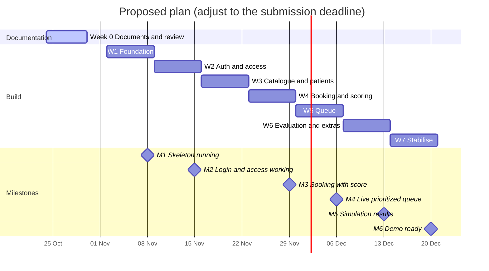
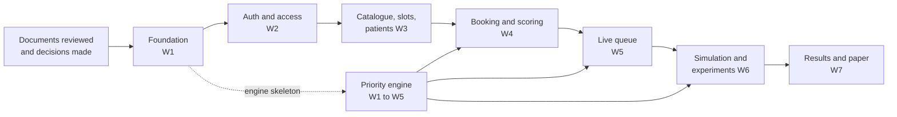

# DOC 7: Task Tracker and Project Plan

> Plan, task breakdown, milestones and progress tracking for building the **Smart Healthcare Appointment and Patient Prioritization System** on the revised stack (Next.js, React, Firebase, Node via route handlers). It replaces the Java-based development plan in Section 19 of the master document and uses the architecture, schema, API, frontend and UI documents (DOC_1 to DOC_6) as its source.

| | |
|---|---|
| **Document** | DOC_7_TASK_TRACKER |
| **Version** | 0.1 (Draft for team review) |
| **Date** | 2026-10-26 |
| **Depends on** | Master document (README), DOC_1 to DOC_6 |
| **Course** | B.Tech CSE, 7th Semester, Engineering Clinics |
| **Guide** | Harshit Mishra |

> **Assumptions to confirm.** The calendar dates below are **proposed**: they assume Week 0 (documentation) runs 24 to 30 Oct 2026 and Week 1 starts on Monday 2 Nov 2026. The college submission deadline and the viva date were not given, and the owners of the four roles are not yet assigned. Replace the dates and owners once these are known (Section 3 and Section 4).

---

## Table of Contents

1. [How to Use This Tracker](#1-how-to-use-this-tracker)
2. [Scope and Priorities](#2-scope-and-priorities)
3. [Team and Ownership](#3-team-and-ownership)
4. [Schedule Overview](#4-schedule-overview)
5. [Milestones and Exit Criteria](#5-milestones-and-exit-criteria)
6. [Task Breakdown by Week](#6-task-breakdown-by-week)
7. [Feature Traceability](#7-feature-traceability)
8. [Dependencies and Critical Path](#8-dependencies-and-critical-path)
9. [If We Fall Behind](#9-if-we-fall-behind)
10. [Definition of Done and Working Agreements](#10-definition-of-done-and-working-agreements)
11. [Testing Plan Summary](#11-testing-plan-summary)
12. [Decisions Needed](#12-decisions-needed)
13. [Remaining Documents](#13-remaining-documents)
14. [Risks](#14-risks)
15. [Weekly Progress Log](#15-weekly-progress-log)
16. [Changelog](#16-changelog)

---

## 1. How to Use This Tracker

| Item | Rule |
|---|---|
| **Task ID** | `W<week>-<number>`, for example `W4-03`. IDs never change; a cancelled task keeps its ID with status `Dropped` |
| **Owner role** | **A** Auth, Users and Access; **B** Booking, Catalogue and Reception; **C** Priority, Queue and Simulation; **D** Frontend Lead and QA (Section 3). "All" means every member |
| **Size** | **S** up to half a day, **M** about one day, **L** two to three days |
| **Priority** | **M** Must (needed for the minimum viable demo), **S** Should, **C** Could |
| **Status** | `Todo`, `In progress`, `Blocked`, `In review`, `Done`, `Dropped` |
| **Docs** | The document and section that define the task |
| **Updating** | Whoever works on a task updates its status in the same pull request. The Frontend Lead and QA role checks the tracker at the weekly review |
| **Reviews** | Shared documents (DOC_1 to DOC_7 and the master document) change only through a pull request, with a short note in their changelog |

---

## 2. Scope and Priorities

### 2.1 Minimum viable demo (must never be dropped)

From the master document: **F1 to F7**, plus core booking, authentication and dashboards. The revised requirements add the following, which are also **must-haves**:

| New requirement | Where defined |
|---|---|
| Four roles including a **Receptionist** who can book slots and register walk-ins for offline patients | DOC_1 Section 6, DOC_3 Section 6 |
| **Admin-created** doctor, receptionist and admin accounts; staff log in with credentials and forgot-password only | DOC_1 Section 6.2, DOC_4 U1, A2 |
| **Admin control over access:** role defaults plus per-user grants and denies, disable accounts | DOC_1 Section 6.3, DOC_4 U2 |
| One shared Firebase project for local and deployed use | DOC_1 Section 12, DOC_2 |

**F5 (simulation and evaluation) is the proof for the research paper and is never dropped.**

### 2.2 Feature priority

| Group | Features | Priority |
|---|---|---|
| Research core | F1 explainable score, F2 aging, F3 red-flag override, F4 unified queue, F5 simulation, F6 tunable parameters and audit log, F7 doctor override with reason | **Must** |
| Product | F8 position and estimated wait, F9 no-show handling, F11 analytics | **Should** |
| Product | F10 email (booking confirmation and cancellation only; reminders deferred), F12 Hindi UI, F13 ABHA field | **Could** (dropped first) |
| Future scope | ML triage, ABDM integration, SMS, payments, native apps | Not in this phase |

---

## 3. Team and Ownership

| Name | Roll No. |
|---|---|
| Rohit Mani Tiwari | 2420363 |
| Rishi Kumar Singh | 2420361 |
| Shiwang Singh | 2420364 |
| Dharmu Kumar | 2420353 |

Each member owns a **vertical slice** (server operations plus the matching screens), so work can run in parallel once the shared documents are final.

| Role | Owner | Main modules | Secondary |
|---|---|---|---|
| **A: Auth, Users and Access** | _TBD_ | Firebase setup, auth provider and guards, registration, forced password change, admin user management, **access editor**, permission constants, Firestore rules and rules tests, audit log, scoring configuration page | Reports |
| **B: Booking, Catalogue and Reception** | _TBD_ | Specializations, doctors, slots, patient profiles and search, appointment booking, symptom wizard, cancel, check-in, **reception desk, book for patient, walk-in**, patient dashboard, emails | Appointment slip |
| **C: Priority, Queue and Simulation** | _TBD_ | Priority engine, scoring, aging, live queue, consultation, overrides, queue status, no-show sweep, **simulation module**, experiments for the paper | Research paper |
| **D: Frontend Lead and QA** | _TBD_ | Repository and CI, app shell, shared components, design tokens, i18n, accessibility, integration and end-to-end tests, test cases, deployment, documentation consistency | Admin charts |

**Ground rules:** short daily sync, one pull request per feature, at least one reviewer per pull request, shared documents change only by pull request.

---

## 4. Schedule Overview

Seven working weeks after documentation, as in the master document. All dates are **proposed** and must be aligned with the submission deadline.

| Phase | Proposed dates | Focus |
|---|---|---|
| **Week 0: Documentation** | 24 to 30 Oct 2026 | Master document, DOC_1 to DOC_7, team review, decisions |
| **Week 1: Foundation** | 2 to 8 Nov | Repository, Next.js app, Firebase project, rules, seed, shared constants |
| **Week 2: Auth and access** | 9 to 15 Nov | Login, registration, roles, admin user management, access editor |
| **Week 3: Catalogue and patients** | 16 to 22 Nov | Specializations, doctors, slots, patient search, doctor and slot discovery. **Scope freeze at the end of this week** |
| **Week 4: Booking and scoring** | 23 to 29 Nov | Priority engine, symptom form, booking (patient and reception), emails |
| **Week 5: Queue** | 30 Nov to 6 Dec | Check-in, live queue with aging, walk-ins, consultation, overrides, queue status, no-show |
| **Week 6: Evaluation and extras** | 7 to 13 Dec | Simulation, experiments, configuration editor, audit log view, reports, Hindi |
| **Week 7: Stabilise** | 14 to 20 Dec | Testing, security and accessibility review, polish, demo data, report, presentation, paper draft |

---

## 5. Milestones and Exit Criteria

| ID | End of | Milestone | Exit criteria (all must be true) |
|---|---|---|---|
| **M1** | Week 1 | Skeleton running | App runs locally and on Vercel against the **same** Firebase project; rules and indexes deploy from the repository; seed script creates the first admin, config version 1 and specializations; CI runs lint, type check and tests on pull requests |
| **M2** | Week 2 | Login and access working | All four roles can log in; patients can self-register; admin creates doctor, receptionist and admin accounts; first-login password change works; admin can grant, deny and disable and the change takes effect without a manual re-login; a role-less account reads nothing |
| **M3** | Week 4 | Booking with score | A patient and a receptionist can book a slot; the score and breakdown are stored; red flags show the emergency notice; symptom edit and cancel work; engine unit tests (including the six worked examples) pass; the **concurrent booking test passes** |
| **M4** | Week 5 | Live prioritized queue | Check-in with server time; doctor's live queue ordered with aging; walk-ins in the same queue; override with reason and audit; consultation start and complete; patient sees position and estimate; no-show derived and persisted |
| **M5** | Week 6 | Simulation results | FCFS, priority-only and priority plus aging run on seeded synthetic data with at least 30 replications; metrics and charts exported; reference triage scenarios evaluated; configuration editor and audit log page work |
| **M6** | Week 7 | Demo ready | All Must tasks done; security and accessibility checks complete; demo data and script ready; user acceptance session held; report, presentation and paper draft with results ready; production deployment verified |

---

## 6. Task Breakdown by Week

### Week 0: Documentation (24 to 30 Oct)

| ID | Task | Owner | Size | Pri | Depends | Docs | Status |
|---|---|---|---|---|---|---|---|
| W0-01 | Master document (README) v0.1 | All | L | M | none | README | Done |
| W0-02 | DOC_1 System Architecture | All | L | M | W0-01 | DOC_1 | In review |
| W0-03 | DOC_2 Firebase Setup Guide | All | M | M | W0-02 | DOC_2 | In review |
| W0-04 | DOC_3 Database Schema | All | L | M | W0-02 | DOC_3 | In review |
| W0-05 | DOC_4 API Specification | All | L | M | W0-04 | DOC_4 | In review |
| W0-06 | DOC_5 Frontend Architecture | All | L | M | W0-05 | DOC_5 | In review |
| W0-07 | DOC_6 UI Design | All | L | M | W0-06 | DOC_6 | In review |
| W0-08 | DOC_7 Task Tracker (this document) | All | M | M | W0-07 | DOC_7 | In review |
| W0-09 | Team reads all documents; list questions and corrections | All | M | M | W0-08 | DOC_1 to DOC_7 | Todo |
| W0-10 | Resolve the decisions marked "before Week 1" (Section 12), assign role owners, fix real dates | All | M | M | W0-09 | Section 12 | Todo |
| W0-11 | Update the master document to the new stack (Sections 9, 10, 13, 14, 15, 17, 19 and the roles) so it no longer contradicts DOC_1 to DOC_7 | D | M | M | W0-10 | README | Todo |
| W0-12 | Priority Engine Specification: final numbers, edge cases, more worked examples | C | L | M | W0-10 | README Section 11 | Todo |
| W0-13 | Share documents with the guide and note feedback | All | S | S | W0-10 | | Todo |

### Week 1: Foundation (M1), 2 to 8 Nov

| ID | Task | Owner | Size | Pri | Depends | Docs | Status |
|---|---|---|---|---|---|---|---|
| W1-01 | Create the GitHub repository, branches, branch protection, pull request template | D | S | M | W0-10 | README Section 23 | Todo |
| W1-02 | Create the Next.js TypeScript app with Tailwind, shadcn/ui, ESLint, Prettier and the `@/` alias | D | M | M | W1-01 | DOC_5 Section 2 | Todo |
| W1-03 | Create the Firebase project (Spark, Mumbai), enable Auth and Firestore, register the web app | A | S | M | W0-10 | DOC_2 Steps 1 to 4 | Todo |
| W1-04 | Environment files, `.env.example`, Firebase client and admin helpers | A | S | M | W1-03 | DOC_2 Step 6 | Todo |
| W1-05 | Deploy the skeleton to Vercel, add the domain to Firebase authorized domains, confirm the shared project | D | M | M | W1-02, W1-04 | DOC_2 Step 10 | Todo |
| W1-06 | Constants module: permission keys, `ROLE_DEFAULTS`, enums, plus a test that claims stay under 900 bytes | A | M | M | W1-02 | DOC_3 Section 6 | Todo |
| W1-07 | Shared Zod schemas and types skeleton | D | M | M | W1-06 | DOC_5 Section 9 | Todo |
| W1-08 | Priority engine package skeleton, types and first unit tests (point tables, age bands) | C | M | M | W1-02 | DOC_1 Section 8 | Todo |
| W1-09 | Firestore rules v1, indexes file, CLI deploy, rules test setup | A | L | M | W1-03, W1-06 | DOC_3 Sections 10 and 11 | Todo |
| W1-10 | Seed script: first admin, config version 1, counters, specializations | A | M | M | W1-04, W1-06 | DOC_2 Step 8, DOC_3 Section 12 | Todo |
| W1-11 | `authorize()` helper, error and response helpers, `GET /api/health` | A | M | M | W1-04, W1-06 | DOC_4 Section 3 | Todo |
| W1-12 | App shell, providers (auth, query, i18n, toast), design tokens, base layout | D | L | M | W1-02 | DOC_5 Section 12, DOC_6 Section 3 | Todo |
| W1-13 | i18n provider, `en.json` and `hi.json` skeletons, key parity test | D | M | S | W1-12 | DOC_5 Section 10 | Todo |
| W1-14 | CI: lint, type check and unit tests on every pull request | D | M | M | W1-02 | DOC_5 Section 16 | Todo |

### Week 2: Auth and access (M2), 9 to 15 Nov

| ID | Task | Owner | Size | Pri | Depends | Docs | Status |
|---|---|---|---|---|---|---|---|
| W2-01 | `AuthProvider` and `useSession`: claims, user document listener, `permVersion` token refresh, disabled-account handling | A | L | M | W1-12, W1-10 | DOC_5 Section 4 | Todo |
| W2-02 | Login, logout and forgot-password pages, generic error messages, persistence choice | A | M | M | W2-01 | DOC_5 Section 4.2 | Todo |
| W2-03 | Patient registration page, `POST /api/auth/complete-patient-profile` (A1) and `/register/complete` | A | L | M | W2-01, W1-11 | DOC_4 A1 | Todo |
| W2-04 | `AreaGate`, `useCan`, `Can`, `RequirePermission` and navigation generated from permissions | D | L | M | W2-01 | DOC_5 Section 5 | Todo |
| W2-05 | `POST /api/auth/change-initial-password` (A2) and the forced change page | A | M | M | W2-01 | DOC_4 A2 | Todo |
| W2-06 | `POST /api/admin/users` (U1) and the create-user form with the secret-once dialog | A | L | M | W2-04, W1-11 | DOC_4 U1, DOC_6 Section 7.11 | Todo |
| W2-07 | `PUT /api/admin/users/{uid}/access` (U2) with last-admin and self-change protection and claims update | A | L | M | W2-06 | DOC_4 U2 | Todo |
| W2-08 | `POST /api/admin/users/{uid}/reset-password` (U3) | A | S | S | W2-06 | DOC_4 U3 | Todo |
| W2-09 | Admin user list, user detail and **access editor** UI | A | L | M | W2-07 | DOC_6 Section 7.12 | Todo |
| W2-10 | Audit entry helper used inside transactions; audit writes for user and access events | A | M | M | W2-06 | DOC_3 Section 7.11 | Todo |
| W2-11 | Rules tests: role-less denied, patient sees only own data, disabled account blocked | A | M | M | W1-09, W2-03 | DOC_3 Section 11 | Todo |
| W2-12 | Role home pages (placeholders) and redirects after login | D | S | M | W2-04 | DOC_5 Section 3 | Todo |
| W2-13 | Handler tests for A1, A2, U1, U2: allowed and denied roles, disabled, password change pending | D | M | M | W2-07 | DOC_4 Section 12 | Todo |

### Week 3: Catalogue, slots and patients, 16 to 22 Nov

| ID | Task | Owner | Size | Pri | Depends | Docs | Status |
|---|---|---|---|---|---|---|---|
| W3-01 | Specializations: C1, C2 handlers and admin page | A | M | M | W2-07 | DOC_4 C1, C2 | Todo |
| W3-02 | Doctors: C3 handler, admin doctors page (accounts created through U1) | A | M | M | W3-01 | DOC_4 C3 | Todo |
| W3-03 | Slot generation S1 and block S2; slot pages for doctors and admin | B | L | M | W3-02 | DOC_4 S1, S2 | Todo |
| W3-04 | Patient discovery: specialization, doctor and slot picker with Firestore hooks | B | L | M | W3-03 | DOC_5 Section 6.2, DOC_6 Section 7.3 | Todo |
| W3-05 | Patient profile page and `PUT /api/patients/{id}` (P2) | B | M | M | W2-03 | DOC_4 P2 | Todo |
| W3-06 | Reception: patient search (phone, code, name prefix), `POST /api/patients` (P1) with duplicate warning | B | L | M | W3-07, W2-04 | DOC_4 P1, DOC_6 Section 7.8 | Todo |
| W3-07 | Patient code counter transaction | B | S | M | W1-10 | DOC_3 Section 7.12 | Todo |
| W3-08 | Reference-data hooks with caching, `useServerNow` | D | M | M | W1-12 | DOC_5 Section 6 | Todo |
| W3-09 | Shared components: data table, badges, empty states, skeletons, dialogs | D | L | M | W1-12 | DOC_6 Section 5 | Todo |
| W3-10 | Rules tests for catalogue, slots and patients | A | M | M | W3-06 | DOC_3 Section 11 | Todo |
| W3-11 | **Scope freeze review**: confirm what is in the demo | All | S | M | W3-06 | README Section 24 | Todo |

### Week 4: Booking and scoring (M3), 23 to 29 Nov

| ID | Task | Owner | Size | Pri | Depends | Docs | Status |
|---|---|---|---|---|---|---|---|
| W4-01 | Engine: red-flag evaluation, base score, age bands, boundaries (age 5 vs 6, 59 vs 60), **the six worked examples as tests** | C | L | M | W0-12, W1-08 | README Section 11 | Todo |
| W4-02 | Active-config reading on server and client; config validation schema | C | M | M | W1-10 | DOC_3 Section 7.10, DOC_4 G1 | Todo |
| W4-03 | `POST /api/appointments` (B1): transaction, overlap check, score and breakdown storage, patient-safe response | B | L | M | W4-01, W4-02, W3-03 | DOC_4 B1 | Todo |
| W4-04 | Symptom wizard with the immediate red-flag notice and translations | B | L | M | W4-01, W3-09 | DOC_5 Section 9, DOC_6 Section 7.3 | Todo |
| W4-05 | Patient booking wizard and confirmation screen | B | L | M | W4-03, W4-04 | DOC_6 Section 7.3 | Todo |
| W4-06 | `PUT .../symptoms` (B3) and `PUT .../cancel` (B4) with slot release | B | M | M | W4-03 | DOC_4 B3, B4 | Todo |
| W4-07 | Reception **book for patient** flow (find or create, slot, symptoms, confirm) | B | L | M | W4-05, W3-06 | DOC_6 Section 7.8 | Todo |
| W4-08 | Email helper (Nodemailer with Gmail app password), booking and cancellation emails | B | M | C | W4-03 | DOC_2 Step 9, DOC_4 Section 8 | Todo |
| W4-09 | **Concurrency test:** parallel bookings of one slot, exactly one succeeds | C | M | M | W4-03 | NFR-09 | Todo |
| W4-10 | Patient dashboard, appointments list and detail (without queue status) | B | M | M | W4-05 | DOC_5 Section 11.2 | Todo |
| W4-11 | Rules tests for appointments and the `clinical` subcollection | A | M | M | W4-03 | DOC_3 Section 11 | Todo |
| W4-12 | Handler tests for B1, B3, B4 and role denials | D | M | M | W4-06 | DOC_4 Section 12 | Todo |
| W4-13 | Printable appointment slip for reception | B | S | C | W4-07 | DOC_6 Section 11.2 | Todo |

### Week 5: Queue (M4), 30 Nov to 6 Dec

| ID | Task | Owner | Size | Pri | Depends | Docs | Status |
|---|---|---|---|---|---|---|---|
| W5-01 | `PUT .../check-in` (B5) with server timestamp; patient and reception check-in UI | B | M | M | W4-03 | DOC_4 B5 | Todo |
| W5-02 | `POST /api/walk-ins` (B2) and the reception walk-in page | B | M | M | W4-03, W3-06 | DOC_4 B2, DOC_6 Section 7.9 | Todo |
| W5-03 | Engine: aging, final score, queue sorting, tie rules, tests including the aging cap | C | L | M | W4-01 | DOC_1 Section 8 | Todo |
| W5-04 | `useLiveQueue`, `QueueTable`, emergency row, breakdown toggle, reorder behaviour | C | L | M | W5-03, W3-08 | DOC_5 Section 7, DOC_6 Section 7.5 | Todo |
| W5-05 | `PUT .../start` (B6), `PUT .../complete` (B7) and the consultation page | C | L | M | W5-04 | DOC_4 B6, B7 | Todo |
| W5-06 | `POST .../override` (B8), override dialog and audit entry | C | M | M | W5-04, W2-10 | DOC_4 B8 | Todo |
| W5-07 | `GET .../queue-status` (B9) and the patient status page with 30 second polling | C | L | S | W5-03 | DOC_4 B9, DOC_6 Section 7.4 | Todo |
| W5-08 | `POST /api/appointments/sweep` (B10), derived no-show display, dashboard triggers | C | M | S | W5-01 | DOC_4 B10 | Todo |
| W5-09 | Reception desk home and queue overview | B | L | M | W5-01, W5-04 | DOC_6 Section 7.7 | Todo |
| W5-10 | Doctor dashboard, today's appointments, own slots and basic statistics | C | M | S | W5-04 | DOC_5 Section 11.3 | Todo |
| W5-11 | Integration test: book, check in, queue, start, complete (patient, reception and walk-in paths) | D | M | M | W5-05 | DOC_5 Section 16 | Todo |
| W5-12 | Measure queue performance (NFR-03) with 200 entries | D | S | S | W5-04 | NFR-03 | Todo |
| W5-13 | Handler tests for B2 and B5 to B10 | D | M | M | W5-08 | DOC_4 Section 12 | Todo |

### Week 6: Evaluation and extras (M5), 7 to 13 Dec

| ID | Task | Owner | Size | Pri | Depends | Docs | Status |
|---|---|---|---|---|---|---|---|
| W6-01 | Simulation core: seeded generator, discrete-event model, FCFS, priority-only and priority plus aging using the shared engine | C | L | M | W5-03 | README Section 21 | Todo |
| W6-02 | Load levels, 30 or more replications, metrics (mean, median and maximum wait by class, percentage seen in time, Jain's index, utilisation) | C | L | M | W6-01 | README Section 21.4 | Todo |
| W6-03 | Reference triage scenarios (30 to 100) and under-triage evaluation | C | L | M | W6-01 | README Section 21.5 | Todo |
| W6-04 | Simulation page with charts and CSV export; `simulation/README.md` with seeds and parameters | C | L | M | W6-02 | DOC_5 Section 11.5 | Todo |
| W6-05 | Run the experiments and collect results for the paper | C | L | M | W6-04 | README Section 21.6 | Todo |
| W6-06 | Configuration editor: `PUT /api/admin/config` (G1), `PUT .../config/active` (G2), version history, diff preview | A | L | M | W4-02 | DOC_4 G1, G2, DOC_6 Section 7.13 | Todo |
| W6-07 | Audit log page with filters and CSV export | A | M | M | W2-10 | DOC_6 Section 7.14 | Todo |
| W6-08 | Reports and analytics pages (F11) | A | L | S | W5-04 | README F11 | Todo |
| W6-09 | Check grant-dependent pages in the reception area (reports, slots, doctors) and the access editor end to end | D | M | S | W2-09, W6-08 | DOC_5 Section 11.4 | Todo |
| W6-10 | Hindi translations for all screens; review of medical wording | D | M | C | W4-04 | DOC_5 Section 10, DOC_6 Section 9 | Todo |
| W6-11 | ABHA optional field on the patient profile (F13) | B | S | C | W3-05 | README F13 | Todo |
| W6-12 | Paper: related work, methods and setup sections drafted | C | L | M | W6-02 | README Section 21.7 | Todo |

### Week 7: Stabilise (M6), 14 to 20 Dec

| ID | Task | Owner | Size | Pri | Depends | Docs | Status |
|---|---|---|---|---|---|---|---|
| W7-01 | Full regression test and bug fixing | All | L | M | W6-05 | | Todo |
| W7-02 | Security review: complete rules tests, handler permission matrix, secret scan, key rotation check, confirm no secrets in the repository | A | L | M | W6-06 | DOC_2 Section 16 | Todo |
| W7-03 | Accessibility pass: automated checks, keyboard walk-through, contrast check of the palette | D | M | S | W6-09 | DOC_6 Section 10 | Todo |
| W7-04 | Responsive and browser testing, UI polish | D | L | S | W7-01 | DOC_6 Section 12 | Todo |
| W7-05 | Demo data and demo script with fictional accounts for all four roles | B | M | M | W7-01 | DOC_3 Section 12 | Todo |
| W7-06 | User acceptance session with the guide and 2 to 3 classmates; bug list | D | M | M | W7-05 | README Section 20 | Todo |
| W7-07 | Final report, presentation, updated README and setup guide | All | L | M | W7-01 | | Todo |
| W7-08 | Paper draft with results, discussion and limitations | C | L | M | W6-05 | README Section 21.7 | Todo |
| W7-09 | Production deployment check on Vercel and the shared Firebase project; confirm the seed script can rebuild demo data | A | S | M | W7-05 | DOC_2 Section 14 | Todo |
| W7-10 | Release tag and code freeze | D | S | M | W7-09 | README Section 23 | Todo |

---

## 7. Feature Traceability

| Feature | Description | Main tasks | Priority |
|---|---|---|---|
| F1 | Explainable priority score | W4-01, W4-03, W5-04 (breakdown view) | Must |
| F2 | Aging-based fairness | W5-03, W5-04 | Must |
| F3 | Red-flag override and emergency notice | W4-01, W4-04, W4-05 | Must |
| F4 | Unified queue (online, reception and walk-in) | W4-07, W5-02, W5-04, W5-09 | Must |
| F5 | Simulation and evaluation | W6-01 to W6-05 | Must (never dropped) |
| F6 | Tunable parameters and audit log | W6-06, W6-07, W2-10 | Must |
| F7 | Doctor override with reason | W5-06 | Must |
| F8 | Queue position and estimated wait | W5-07 | Should |
| F9 | No-show handling | W5-08 | Should |
| F10 | Email notifications (confirmation and cancellation only) | W4-08 | Could |
| F11 | Analytics | W5-10, W6-08 | Should |
| F12 | Hindi UI | W1-13, W6-10 | Could |
| F13 | ABHA-ready field | W6-11 | Could |
| New: Receptionist | Offline booking, patient search and creation, walk-in, check-in | W3-06, W4-07, W5-01, W5-02, W5-09 | Must |
| New: Admin-created staff and access control | Create accounts, grants and denies, disable | W2-05 to W2-10 | Must |

---

## 8. Dependencies and Critical Path

| Point | Consequence |
|---|---|
| **Auth and access (W2) blocks everything that needs a logged-in user** | Role A must finish login, roles and the authorize helper first. Others work on shared components, the engine and slot or patient logic meanwhile |
| **The priority engine is a pure module** | Role C can build and test it from Week 1 without waiting for the UI or database; it also feeds the simulation |
| **The simulation (F5) needs only the engine** | If the queue work slips, role C can still start the simulation core in Week 5 so the paper is not at risk |
| **Booking (W4) needs slots (W3) and the active config (W1)** | Slot generation and the seed script must be reliable early |
| **Decisions block specific tasks** | Final scoring numbers must be fixed before W4-01 (Section 12) |

---

## 9. If We Fall Behind

Cut in this order and tell the guide. **Never cut** F1 to F7, the receptionist flows, admin-created accounts and access control, or any test of rules and permissions.

| Order | Cut | Effect |
|---|---|---|
| 1 | Playwright end-to-end tests (keep unit, handler and integration tests) | Less automated UI coverage |
| 2 | Printable appointment slip (W4-13) | Reception writes the slot time by hand |
| 3 | Doctor statistics and reports polish (W5-10, W6-08), keeping the minimum charts for the paper | Fewer dashboards |
| 4 | F13 ABHA field (W6-11) | Field omitted |
| 5 | F10 emails (W4-08) | No confirmation email; patients see the booking on screen |
| 6 | F12 Hindi: translate patient screens and the emergency notice only (W6-10) | Partial Hindi |
| 7 | F8 estimated wait: keep position only (W5-07) | Simpler status card |
| 8 | Password reset by admin (W2-08) | Staff use the email reset |

---

## 10. Definition of Done and Working Agreements

### 10.1 A task is done when

- [ ] The code is merged through a pull request with at least one review
- [ ] Lint, type check and tests pass in CI
- [ ] New logic has unit tests; new handlers have permission tests (allowed role, denied role, no token)
- [ ] Rules changes have rules tests
- [ ] All new text has English and Hindi keys (the Hindi may be a placeholder until W6-10)
- [ ] The screen has loading, empty and error states and works at phone and desktop widths
- [ ] The relevant document is updated through the same pull request if behaviour changed
- [ ] The tracker status is updated

### 10.2 Working agreements

| Topic | Agreement |
|---|---|
| Sync | Short daily sync (15 minutes) and a weekly review against the milestone exit criteria |
| Branches | `main` always demo-ready; `develop` for integration; feature branches `feat/<task-id>-short-name` |
| Commits | Conventional commits referencing the task ID (for example `feat(W4-03): booking handler`) |
| Pull requests | One per task or small group of tasks; reviewer from a different role where possible |
| Secrets | Never in the repository or chat; follow DOC_2 Section 16 |
| Shared data | The Firebase project is shared; use clearly labelled test accounts; deploy rules only from `main` or after review |
| Blockers | Raise in the daily sync; mark the task `Blocked` with the reason |
| Scope | Frozen at the end of Week 3 except by team agreement and a note in the tracker |

---

## 11. Testing Plan Summary

Updated from Section 20 of the master document for the new stack.

| Level | Tool | What to test |
|---|---|---|
| Unit | Vitest | Priority engine (every table row, red flags, caps, boundaries, the six worked examples), `sortQueue` ordering and ties, aging cap, `displayStatus`, permission helpers, claims size, i18n key parity |
| Rules | Firebase rules test library with the emulator | Role-less denied, patient own data only, doctor own queue, receptionist cannot read consultation notes, disabled account blocked, no client writes to protected collections |
| Handler | Vitest calling handlers with mocked requests | Status codes, validation errors, role and permission checks (403), ownership checks, state errors (409), audit entries written |
| Integration | Vitest or scripts against a test project | Book, check in, queue, start, complete; patient, reception and walk-in paths |
| Concurrency | Parallel requests | Two bookings of one slot, exactly one succeeds (NFR-09) |
| Component | Testing Library | Forms, gates, `QueueTable` with a fixed clock, symptom wizard notice, secret-once dialog |
| End-to-end (optional) | Playwright | Register and book; reception books an offline patient; check-in and queue order; override; admin creates staff and changes access |
| Simulation | Fixed seeds | Same seed gives identical output; hand-checked small cases |
| Accessibility | axe and manual keyboard | Key pages in both languages |
| UAT | Demo with the guide and 2 to 3 classmates | Usability feedback and bug list |

**Priority test cases first:** the six worked examples in Section 11.4 of the master document and the permission matrix tests for every handler.

---

## 12. Decisions Needed

Decisions that block work, with the week by which they must be made. Full lists are in each document's Open Decisions section.

| # | Decision | Needed by | Owner | Proposal |
|---|---|---|---|---|
| 1 | **Submission deadline, viva date and real calendar** | Before W1 | Team and guide | Use these to replace the proposed dates |
| 2 | **Role owners A to D** | Before W1 | Team | Agree in W0-10 |
| 3 | Final scoring numbers (master D1) | Before W4-01 | Team and guide | Use the initial values in Section 11 of the master document and tune later through configuration |
| 4 | Range of manual priority adjustment (DOC_4 O3) | Before W5-06 | Team | -50 to +50 |
| 5 | Strict hiding of scores from the receptionist (DOC_3 O3) | Before W1-09 (affects rules and schema) | Team | UI-only for now |
| 6 | Can patients read their own consultation notes (DOC_3 O4) | Before W1-09 | Team and guide | Yes, read-only |
| 7 | Patient score visibility (DOC_1 O5) | Before W4-03 | Team | Position and wait only |
| 8 | Temporary password or email setup link for new staff (DOC_1 O3) | Before W2-06 | Team | Temporary password shown once |
| 9 | Early check-in window (DOC_4 O4) | Before W5-01 | Team | Appointment date only |
| 10 | Simulation distributions and reference scenarios source (master D6) | Before W6-01 | Team and guide | Document assumptions; verify scenarios with a clinician or student |
| 11 | Target journal or conference (master D8) | Before W6-12 | Team and guide | Open |
| 12 | Product name and logo (DOC_6 U1) | Before W7 | Team | Placeholder wordmark |
| 13 | Hindi wording review (DOC_5 F4) | Before W7 | Team | Native speaker or clinician |
| 14 | Staff idle sign-out and emergency alert style (DOC_5 F2, F3) | Before W5-04 | Team | 30 minutes; visual alert |

**Already decided:** Next.js with TypeScript and Tailwind; Firebase (Spark, Mumbai) shared by local and deployed; no Express; receptionist as a separate role; per-user grants and denies; direct Firestore reads with server-side writes; no scheduler; shared JavaScript priority engine; real-time queue listeners instead of polling for staff.

---

## 13. Remaining Documents

| Document | Purpose | Needed before |
|---|---|---|
| **Priority Engine Specification** (proposed `DOC_8`) | Final point tables, edge cases and many worked examples; the test source for the engine | W4-01 (task W0-12) |
| **Test Plan** (proposed `DOC_9`) | Expands Section 11: cases per handler, rule test list, UAT script | W4 |
| **Research paper outline and simulation design note** | Research questions, simulation parameters, metrics, reference scenarios | W6-01 |
| **Master document update** | Align the README with the new stack and roles (task W0-11) | W1 |
| **Demo script** | Step-by-step demo for the viva | W7-05 |

The master document's old roadmap names (`docs/01-srs.md` to `docs/10-research-paper/`) are replaced by this `DOC_n` series; an SRS can be rebuilt from the requirements list if the college requires one.

---

## 14. Risks

Risks specific to this plan. General risks are in Section 24 of the master document.

| Risk | Likelihood | Mitigation |
|---|---|---|
| Learning curve for Firebase, security rules and the Admin SDK | High | DOC_2 walkthrough; Week 1 spike on rules and claims; pair on W1-09 and W2-07 |
| Security rules and permissions are subtle and break silently | Medium | Rules tests from Week 1; handler permission tests for every endpoint |
| Auth work in Week 2 blocks others | Medium | Others work on the engine, shared components and slot logic in parallel (Section 8) |
| Scope creep from new ideas | Medium | Scope freeze at the end of Week 3; "If we fall behind" list |
| Free-tier quota exhausted during testing or the demo | Low to medium | Watch the usage tab; narrow queries; avoid heavy loops in tests against the shared project |
| Shared Firebase project polluted by test data | Medium | Labelled test accounts; the seed script can rebuild demo data |
| Hosting limits on Vercel's free plan | Low | Handlers are short; no scheduler; test the deployed build early (W1-05) |
| Simulation results are weak or unclear | Medium | Start the simulation early (Section 8); document assumptions; run sensitivity checks |
| Team availability varies | Medium | Vertical ownership and a weekly review; cut list in Section 9 |
| Documents drift from the code | Medium | Update documents in the same pull request; consistency check in W7-07 |

---

## 15. Weekly Progress Log

Fill this in at each weekly review.

| Week | Planned tasks | Done | Blocked | Milestone met? | Notes and decisions |
|---|---|---|---|---|---|
| 0 | 13 | | | | |
| 1 | 14 | | | M1 | |
| 2 | 13 | | | M2 | |
| 3 | 11 | | | Scope freeze | |
| 4 | 13 | | | M3 | |
| 5 | 13 | | | M4 | |
| 6 | 12 | | | M5 | |
| 7 | 10 | | | M6 | |

**Counting rule:** a task counts as done only when it meets the Definition of Done (Section 10.1).

---

## 16. Changelog

| Version | Date | Author | Changes |
|---|---|---|---|
| 0.1 | 2026-10-26 | Team | First draft of the plan on the Next.js and Firebase stack: schedule, milestones, 99 tasks across 8 weeks, traceability, cut list, decisions and risks. |
