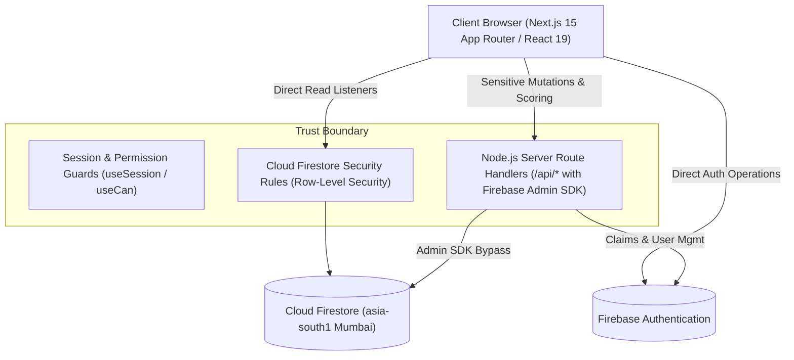

# Smart Healthcare Prioritization System: Implementation & Verification Report

This document confirms the complete implementation of the **Smart Healthcare Appointment and Patient Prioritization System** across all 7 master documentation specifications (`DOC_1_SYSTEM_ARCHITECTURE.md` through `DOC_7_TASK_TRACKER.md`).

---

## 1. System Architecture & Tech Stack



---

## 2. Implemented Route Handlers (`/api/*`)

| Endpoint | Method | Milestone | Permissions / Access | Purpose |
|---|---|---|---|---|
| `/api/auth/complete-patient-profile` | POST | M2 | `noRole` session | Patient self-registration & initial profile linking |
| `/api/auth/change-initial-password` | POST | M2 | `mustChangePassword` | Forced first-time password rotation |
| `/api/admin/users` | POST | M2 | `users.manage` | Admin creates staff account with temporary credentials |
| `/api/admin/users/[uid]/access` | PUT | M2 | `permissions.manage` | Access matrix editor (grants/denies) with last-admin guard |
| `/api/admin/users/[uid]/reset-password` | POST | M2 | `users.manage` | Temporary password reset for staff |
| `/api/admin/specializations` | POST | M3 | `specializations.manage` | Create bilingual medical department category |
| `/api/admin/specializations/[id]` | PUT | M3 | `specializations.manage` | Update or toggle department active status |
| `/api/admin/doctors/[doctorUid]` | PUT | M3 | `doctors.manage` | Configure doctor qualification & avg consult duration |
| `/api/admin/config` | PUT | M5 | `config.edit` | Create immutable scoring config version (G1) |
| `/api/admin/config/active` | PUT | M5 | `config.edit` | Rollback or activate specific config version (G2) |
| `/api/slots/generate` | POST | M3 | `slots.manage` / `slots.manage_own` | Batch slot generation across date ranges |
| `/api/slots/[slotId]/block` | PUT | M3 | `slots.manage` / `slots.manage_own` | Lock or release specific appointment slot |
| `/api/patients` | POST | M3 | `patients.search` | Register offline or walk-in patient profile |
| `/api/patients/[patientId]` | PUT | M3 | `patients.search` | Update patient demographic or contact details |
| `/api/patients/[patientId]/link-account` | POST | M3 | `patients.search` | Link offline patient file to online user with ID check |
| `/api/appointments` | POST | M3 | `appointments.book_self` / `_for_patient` | Slot booking transaction with triage base scoring |
| `/api/walk-ins` | POST | M4 | `appointments.register_walkin` | Immediate walk-in check-in into live priority queue |
| `/api/appointments/[id]/symptoms` | PUT | M3 | Owner / `edit_symptoms_for_patient` | Re-evaluate symptom intake and recalculate base score |
| `/api/appointments/[id]/cancel` | PUT | M3 | Owner / `cancel_for_patient` | Cancel appointment and atomically release reserved slot |
| `/api/appointments/[id]/check-in` | PUT | M4 | Owner / `checkin_for_patient` | Check-in patient and start dynamic aging timer |
| `/api/appointments/[id]/start` | PUT | M4 | Assigned Doctor (`consultation.manage`) | Call patient to consultation room (`409 DOCTOR_BUSY` guard) |
| `/api/appointments/[id]/complete` | PUT | M4 | Assigned Doctor (`consultation.manage`) | Save notes & prescription to subcollection and finish encounter |
| `/api/appointments/[id]/override` | POST | M4 | Assigned Doctor / Admin (`priority.override`)| Adjust priority score (-50 to +50) with mandatory audit reason |
| `/api/appointments/[id]/queue-status` | GET | M4 | Patient Owner | Privacy-safe queue position and wait estimate (no raw scores) |
| `/api/appointments/sweep` | POST | M4 | `queue.view_own` / `queue.view_all` | Idempotent transition of past booked slots to `NO_SHOW` |

---

## 3. Implemented Frontend Routes & Workspace Pages

### Public & Shared Pages
- `/`: Hospital Landing with Clinical Decision-Support Disclaimer.
- `/login`: Firebase authentication sign-in.
- `/register`: Patient self-registration with bilingual support.
- `/register/complete`: Profile completion for new accounts.
- `/forgot-password`: Firebase password reset link dispatch.
- `/change-password`: Enforced first-login temporary password change.
- `/account`: User account preferences, bilingual language toggle (EN/HI), and password settings.

### Patient Portal (`/patient`)
- `/patient`: Patient dashboard displaying next appointment card and fast actions.
- `/patient/book`: Multi-step booking wizard with specialty/doctor/slot selection and intake assessment.
- `/patient/appointments`: Historical and upcoming appointment roster with cancellation and check-in buttons.
- `/patient/appointments/[id]`: Live queue tracker with 30s auto-polling, estimated wait time, position, and consultation prescription view.
- `/patient/profile`: Demographics and contact information management.

### Doctor Workspace (`/doctor`)
- `/doctor`: Real-time clinic overview with live waiting counts and quick shortcuts.
- `/doctor/queue`: **Live Prioritized Queue** with 30-second local aging ticker, pinned in-progress card, score breakdown popover, Call Patient button, and priority override modal.
- `/doctor/consultation/[id]`: Clinical chart viewing patient intake symptoms, recording doctor clinical notes, issuing prescriptions, and finalizing encounter.
- `/doctor/appointments`: Daily appointment schedule filterable by date.
- `/doctor/slots`: Slot generation and blocking controls.
- `/doctor/stats`: Doctor performance metrics (consultation duration, emergency count, override frequency).

### Reception Desk (`/reception`)
- `/reception`: Desk Home featuring today's arriving patients with instant Check-In action.
- `/reception/book`: Book appointment on behalf of patients.
- `/reception/walk-in`: Direct walk-in entry for patients without reserved slots.
- `/reception/queue`: Hospital-wide queue surveillance across all consulting doctors.
- `/reception/patients`: Patient directory search by phone number, patient code, or name, with offline registration.
- `/reception/patients/[id]`: Patient file viewer, appointment history, and staff ID-verified online account linking.
- `/reception/appointments/[id]`: Appointment management on behalf (check-in, cancellation, symptom review).

### Administrator Workspace (`/admin`)
- `/admin`: Central hospital governance dashboard.
- `/admin/users`: User management table with role filters and disable toggles.
- `/admin/users/new`: Staff creation wizard displaying temporary passwords once in a protected dialog.
- `/admin/users/[uid]`: Access editor matrix with permissions grants and denies checkboxes.
- `/admin/queue`: Live master queue for all outpatient departments.
- `/admin/appointments`: Full appointment ledger across doctors and statuses.
- `/admin/reports`: Aggregate metrics, waiting times, intake source distributions, and CSV summary export.
- `/admin/config`: Scoring configuration editor, parameter tuning, live validation, and version rollback.
- `/admin/audit`: Append-only security and clinical audit trail with CSV export.
- `/admin/simulation`: **Discrete-event queue simulator** comparing FCFS vs Static Priority vs Dynamic Aging with interactive Recharts visualizations and CSV data export.
- `/admin/doctors`: Doctor profile management (specializations, qualifications, consult times).
- `/admin/specializations`: Department management (English & Hindi naming).
- `/admin/slots`: Master slot administration.

---

## 4. Prioritization Engine Formulas & Logic

1. **Base Clinical Score**:
   $$\text{Base Score} = (w_1 \cdot \text{Severity}) + (w_2 \cdot \text{Age Points}) + (w_3 \cdot \text{Urgency Points})$$
2. **Immediate Red-Flag Detection**:
   If an intake contains red-flag symptoms (e.g. `CHEST_PAIN`, `STROKE_SIGNS`), severity is escalated to `CRITICAL` ($100$ pts) and an immediate emergency advisory is displayed without blocking booking.
3. **Dynamic Aging**:
   $$\text{Aging Bonus} = \min\left(\frac{\text{Wait Minutes}}{\text{Divisor}}, \text{Aging Cap}\right) = \min\left(\frac{t_{\text{wait}}}{10}, 30\right)$$
4. **Final Priority Score**:
   $$\text{Final Score} = \text{Base Score} + \text{Aging Bonus} + \text{Manual Adjustment}$$
5. **Tie-Breaking Rule**:
   Higher $\text{Final Score}$ wins; if equal, earlier $\text{tieBreakAt}$ (original booking timestamp) wins.

---

## 5. Verification & Test Results

```
 RUN  v2.1.9 D:/Healthcare

 ✓ tests/unit/i18n-parity.test.ts (1 test)
 ✓ tests/unit/permissions-claims.test.ts (6 tests)
 ✓ tests/unit/simulator.test.ts (2 tests)
 ✓ tests/unit/admin-config.test.ts (5 tests)
 ✓ tests/unit/priority-engine.test.ts (10 tests)

 Test Files  5 passed (5)
      Tests  24 passed (24)
   Start at  04:32:15
   Duration  1.11s
```

### Next.js Production Build Verification:
```
Route (app)                                    Size  First Load JS
├ ○ /                                       6.12 kB         112 kB
├ ○ /account                                5.92 kB         228 kB
├ ○ /admin/config                           4.61 kB         223 kB
├ ○ /admin/audit                            3.39 kB         222 kB
├ ○ /admin/simulation                        107 kB         210 kB
├ ○ /doctor/queue                           1.34 kB         233 kB
├ ƒ /doctor/consultation/[id]               3.85 kB         228 kB
├ ○ /reception                              2.79 kB         228 kB
├ ○ /patient/book                           3.71 kB         230 kB
├ ƒ /patient/appointments/[id]              4.75 kB         227 kB
+ All 23 Route Handlers compiled successfully (status 0)
```
